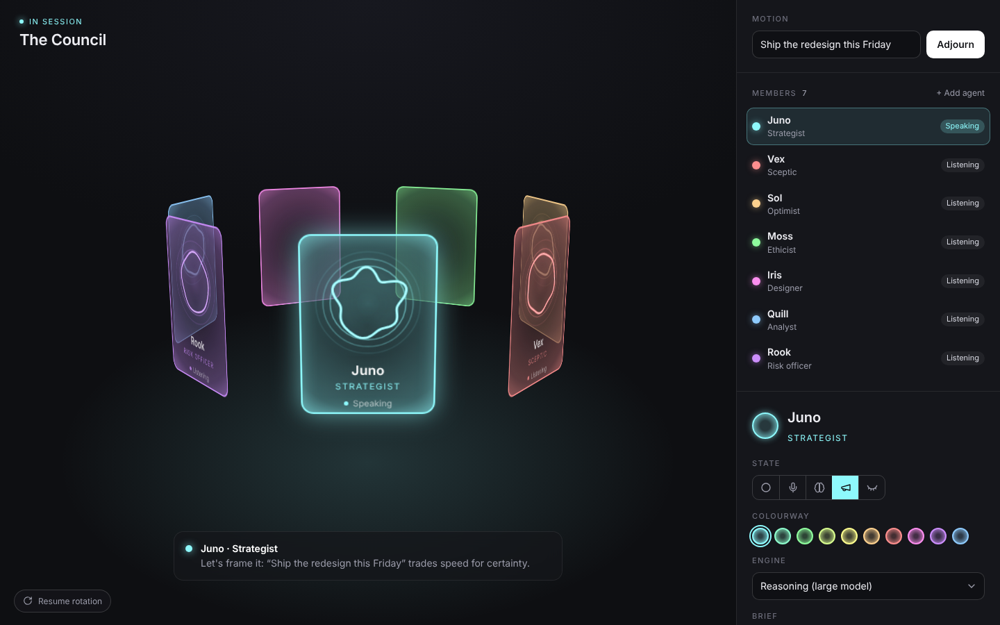

# AI Council

A single screen for a council of AI agents. Each agent is a persona orb on a glass card, and the cards stand in the slowly turning 3D ring from [Rotating cards](../rotating-cards/). Every member has its own colourway and moves in its own way. A side panel shows the roster and the selected member's settings. It is also where real agents plug in.

Plain HTML, CSS and vanilla JS, with no dependencies. Classes are prefixed `ui-council`.



## What's on screen

- **The ring.** Seven members to start with, on glass cards tinted from the Rotating cards palette. The ring turns once every 40s and slows down while you hover over it. Click a card (or a name in the roster) to swing it to the front the short way round. You can also drag the ring sideways: when you let go it settles on the nearest card and selects it. With a card focused, ← / → step through the members.
- **The orbs.** Each orb is a halo, like the [Persona](../persona/) `halo` variant, drawn on a canvas and tinted with the member's colour. It has the same five states. A change of state blends smoothly into the new look:

  | State | What the orb does |
  | --- | --- |
  | Idle | Breathes slowly, with a soft wobble |
  | Listening | Rings are drawn in towards the halo |
  | Thinking | The halo breaks into three arcs that chase each other, with an inner arc turning the other way and three orbiting dots |
  | Speaking | The halo pulses to a speech-like rhythm and pushes rings outward |
  | Asleep | Dims, shrinks a little, and lets a few z's drift up |

  No two orbs move alike: each member gets its own lobe count, speed, line weight and phase, worked out from its id.
- **The floor.** A caption under the ring shows who has the floor and what they are saying. While a member is speaking, their card rises 26px out of the ring, grows 5% and glows brighter in its own colour, with a slow pulse. It settles back into the ring when they finish.
- **The panel.**
  - **Motion** and **Convene**: put a question to the council.
  - **Members**: the roster, with each member's live state. **+ Add agent** goes up to 10 members.
  - **The selected member**: name and role (edit them in place), the five state buttons with tooltips, a colourway picker, the **Engine** that drives them, their **Brief** (the system prompt), their **Lean** (from sceptical to supportive) and their **Vote weight**. **Remove from council** works down to 3 members, and **Reset council** restores the starting seven.

  Edits show on the ring straight away. They are saved in the visitor's browser (`localStorage`), so a refresh keeps the council as it was.

## Convene (the demo)

**Convene** plays a scripted deliberation, so you can see the states working together. The members who are awake all start listening. Then, in order of vote weight, each one thinks for a moment, swings to the front and speaks a line written for their role, word by word. Finally every member votes. A vote follows the member's lean plus a little chance, and counts by their weight. The result appears in the panel and on the floor.

Members who are asleep sit the session out. Press **Adjourn** to stop at any point.

## Plug in real agents

The demo lines are placeholders. `window.Council` is the hook for real agents: read each member's settings, call your model, and drive the orbs from what happens.

```js
const off = Council.on("convene", async ({ motion, order }) => {
  Council.adjourn(); // skip the scripted demo; we'll run it ourselves
  for (const id of order) {
    const agent = Council.get(id);           // { name, role, engine, brief, lean, weight, tint, state }
    Council.select(id);                      // swing them to the front
    Council.setState(id, "thinking");        // request in flight
    const stream = await callYourModel(agent.engine, agent.brief, motion);
    Council.setState(id, "speaking");        // first token arrived
    let text = "";
    for await (const chunk of stream) {
      text += chunk;
      Council.say(id, text);                 // live caption on the floor
    }
    Council.setState(id, "listening");
  }
});
```

| Call | What it does |
| --- | --- |
| `Council.agents()` | A copy of every member |
| `Council.get(id)` | A copy of one member |
| `Council.select(id)` | Selects a member and turns them to the front |
| `Council.setState(id, state)` | `idle`, `listening`, `thinking`, `speaking` or `asleep` |
| `Council.update(id, patch)` | Changes `name`, `role`, `tint`, `engine`, `brief`, `lean` or `weight` |
| `Council.say(id, text)` | Puts a line on the floor in that member's colour |
| `Council.convene()` / `Council.adjourn()` | Starts or stops a session |
| `Council.on(event, fn)` | Listens for `select`, `state`, `change`, `convene` or `vote`. It returns a function that removes the listener |

The **Engine** list (large, medium or small model, or a custom endpoint) is only a label your code reads. Change `ENGINES` in `script.js` to list your real models. Also in `script.js`: `PRESETS` holds the starting members and their briefs, `PALETTE` the colourways, and `LINES` the demo's scripted lines.

## Files

| File | What it is |
| --- | --- |
| `index.html` | The stage, the floor caption and the side panel |
| `style.css` | The 3D ring, the glass cards, the panel and the narrow-screen layout |
| `script.js` | The orb renderer, the ring motion, the panel, Convene and the `Council` API |
| `preview.png` | A still at 1440 × 900, mid-session |

## Layout

The panel is 380px wide on the right. Below 900px it moves under the ring. The ring scales down as one piece to fit the stage, so it never forces sideways scrolling.

## Accessibility

- Cards and roster rows are real buttons. Each card is labelled with the member's name, role and state, and cards facing away drop out of the tab order.
- The floor caption is a polite live region, so screen readers hear who has the floor.
- The state buttons have labels and `aria-pressed`, and the colourways are a radio group you can move through with the arrow keys.
- **Pause rotation** stops the ring. Esc lets it turn again after you have selected a member.
- With **reduced motion** turned on, the ring stays still and jumps straight to the selected card, and the orbs hold still while still showing each state. The speaking card still rises and glows, but without the spring or the pulse.
