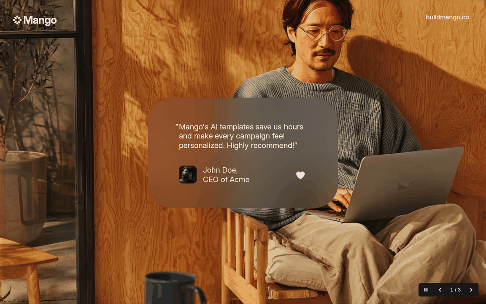

# Animated testimonial card stack-5.5

A testimonial hero rebuilt from Jitter's free template [The Stack: Testimonial](https://jitter.video/template/the-stack-testimonial/) (the *Mango* one). The camera pulls back from a sunlit studio photo as a frosted-glass card settles over it. The quote rises in word by word, then the avatar, the name and a heart appear. The card gives a small squeeze and pops as the heart fills. After that, the next testimonial arrives on top and the older cards step back into a stack behind it.

Plain HTML, CSS and vanilla JS, with no dependencies. Classes are prefixed `st`.

## What it does

The first 5.2 seconds follow the source video frame by frame (1152 × 720, 30 fps):

| Time | What happens |
| --- | --- |
| 0 – 1.5s | The camera zooms out from 1.5× to 1× on `cubic-bezier(.5, 0, 0, 1)`, centred just above the card. The empty glass pane shrinks from a tall 459 × 363 to 415 × 236 with it. |
| 0.63s | The quote rises out of its line mask, one word every 62ms. The opening mark hangs in the margin and fades in. |
| 1.30s | A half-lit heart appears. |
| 1.40s | The avatar grows from a dot. |
| 1.62s | The name and role rise in, one word every 67ms. |
| 1.75 – 2.2s | The box squeezes to 83% while the text stays still, as if the card were being pressed. |
| 2.2 – 3.4s | It pops to 104.5% as the heart lights up with one beat, then settles at 446 × 258. |
| 5.2s | The next testimonial rises into place. The previous card steps back 30 units and scales to 93%. Its text fades, and its top edge peeks out behind the new card. A third card goes further back and fades out. |

The tour loops through the three testimonials. A quote with more words stretches the rest of the timeline to fit.

### Visitor controls

| Input | Action |
| --- | --- |
| Pause / Play button | Stop or restart the rotation |
| Previous / Next buttons | Bring that testimonial to the top of the stack |
| ← / → (focus anywhere in the section) | Previous / next |
| Swipe sideways, or up | Next / previous |
| Hover over the cards, or focus inside | The rotation waits |

## Files

| File | What it is |
| --- | --- |
| `index.html` | The section: header, controls and three testimonial cards |
| `style.css` | Tokens, the glass, the card layout, the compact phone layout and modes |
| `script.js` | The clock, the camera, the box and word animations, the stack, layout and input |
| `images/studio.webp` | The studio photo, 1728 × 1068 (1.5× the source frame) |
| `images/studio-1152.webp` | The same photo at 1152 × 712 for smaller screens |
| `images/avatar-john.webp` | John Doe's avatar, 126 × 126 |
| `preview.png` | The first card at rest, at 1152 × 720 |

### How the photo was made

The template's photo isn't published on its own, so it was rebuilt from the video:

1. Every frame was registered to the last one with ORB features. That recovered the camera: a uniform zoom from 1.502× around (576.6, 334).
2. The opening frames show the photo at 1.5× detail. They were stitched into a 1728 × 1080 canvas with the card, the logo, the URL and the export watermark masked out. Later frames filled in what those had covered.
3. The middle of the photo is under the card in every frame. That 416 × 250 area was filled with the LaMa inpainting model. The wall part got real plywood grain moved down from the upper wall onto LaMa's lighting.
4. The bottom 8 rows were dark export padding, so they were cropped.

The avatar is the average of 55 still frames, upscaled 3×. The Mango mark and the heart are drawn in SVG.

## How it is built

- **One clock.** Every motion is computed from one clock: the camera, the box, every word, the avatar, the heart and the stack depth. Add `?t=2.13` to the URL to freeze any moment for review or screenshots (the squeeze is at its deepest there), and `?autoplay=0` to start paused.
- **Scene units.** Sizes are in pixels of the 1152 × 720 source frame. The photo covers the screen like `object-fit: cover`. On wide screens, the card stays pinned to its spot on the photo, so it always covers the area that was inpainted. If the card would run off the screen there (tablets in portrait, phones), it's freed: it's centred, sized to fit, and placed below the face.
- **Compact phones.** When the scaled type would drop below 15px, the card switches to a 15/20px layout. It's as wide as the screen minus 16px gutters, and the text reflows. The opening zoom is reduced there so the first frame fits.
- **The box moves on its own.** As in the source, only the frosted box squeezes and pops; the text inside never moves. The box is a separate layer sized in px each frame from the card's measured rest size.
- **Glass.** `backdrop-filter: blur(36u) brightness(.94)` over a warm tint, a little deeper toward the bottom. No opacity or filter is set on the card itself: either would make it a backdrop root, and the blur would see nothing.
- **Text.** Inter at 17.8 units on a 21.5 line, sampled colour `#FEECFB`, which matches the source's line widths within 2px.

## Accessibility

- The section is a labelled carousel (`aria-roledescription="carousel"`). Each card is a `role="group"` slide labelled "1 of 3" with a real `<figure>`, `<blockquote>` and `<figcaption>`.
- The quote and name are split into word spans for the animation. Those spans are `aria-hidden`, and screen readers get the plain text from a visually hidden copy.
- Only the top card is exposed. The others are `inert` and `aria-hidden`.
- The rotation controls come first in the reading order, as in the APG carousel pattern. Pause/Play satisfies WCAG 2.2.2. The rotation also waits while focus is inside the section or the mouse is over the cards.
- Moves made by the visitor are announced through a polite live region ("Testimonial 2 of 3: Priya Raman, Brand Lead at Northwind"). The automatic rotation stays quiet.
- **Contrast.** In the source, the name sits at 50% opacity, and the glass drops the quote to 2.6–3.7:1 in places. Here the glass is slightly deeper and the name is at 88%. Measured against the rendered backdrop, every word is at least 4.9:1 for all three cards, at 1152 × 720, 768 × 1024 and 390 × 844. The controls are white on `#19171C`.
- Buttons are 40 × 36px (44 × 44px on touch screens) with a visible two-tone focus ring.
- **Reduced motion.** There's no camera, no word or box motion and no stack travel. Each new card fades in over the last one, already finished.
- In forced-colours mode, the glass becomes a system-coloured panel with a border. Without JavaScript, the first testimonial shows finished and the controls are hidden.
- axe-core (WCAG 2.2 AA plus best practice) reports no violations. It marks contrast over the blur as "needs review", which is what the measurements above cover.

## Customise

- **Testimonials:** each `.st__card` in `index.html`. Use an `` or a ``. Update the `aria-label` count ("2 of 3") if you add cards.
- **Colours:** the `--st-*` tokens at the top of `style.css`.
- **Pace:** the timing constants at the top of `script.js`. `CYCLE` is how long each card stays up.
- **Photo:** replace `images/studio*.webp`. Keep `PHOTO_W`/`PHOTO_H`, `CARD_X`/`CARD_Y` and `CAM_X`/`CAM_Y` in `script.js` in step with where the card should sit on it.
