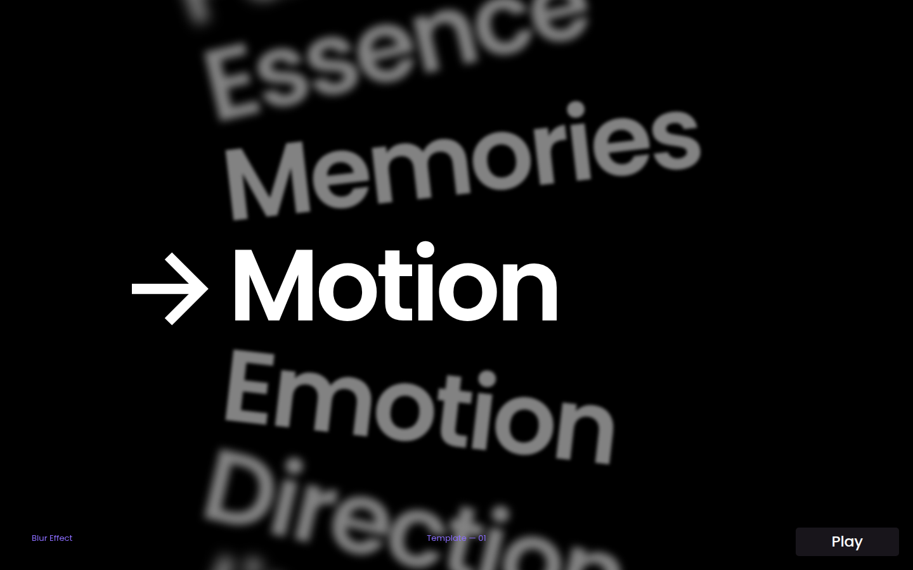

# Blur List

A kinetic word list rebuilt from Jitter's free "List" text animation template (*Blur Effect*, Template 01). Twelve words stand on the spokes of a wheel whose hub sits far off the left of the screen. Every 0.75s the wheel ticks one word up past a white arrow. The word at the arrow is crisp and white, and the rest fade to grey and blur more the further they are from it. Use it for editorial intros and title sequences.

Plain HTML, CSS and vanilla JS, with no dependencies. Classes are prefixed `ui-blur-list`.

## What it does

The page plays the source video's 9s loop (12 words × 0.75s) as a demo, then hands control to the visitor:

1. **Tick (0–0.53s).** The wheel turns one word, `cubic-bezier(.4, 0, 0, .9)`: a quick lift-off, then a long glide in. This curve was fitted to the word's tracked position in the video, frame by frame.
2. **Nudge.** As the next word arrives, the arrow and the list push 28px to the right (frames 3–7), hold for a frame, and settle back by frame 15.
3. **Highlight.** The words cross-fade from grey (`#828282`) to white as they pass the arrow, so half-way through a tick both words are light grey.
4. **Hold (0.53–0.75s).** Then the next tick starts. The order runs Motion, Emotion, Direction, Jitter, Versatile, Life, Journey, Blur Effect, Moments, Pulse, Essence, Memories, and then loops.

### Visitor controls

| Input | Action |
| --- | --- |
| Click or tap a word | Turn it to the arrow (the short way round) |
| ↑ / ↓ (or ← / →) | Previous / next word |
| Home / End | First / last word |
| Scroll wheel or trackpad | One word per notch |
| Drag or swipe up and down | The wheel follows; let go and it settles on the nearest word, and a flick carries it further |
| Pause / Play | Stop or restart the demo |

Once the visitor clicks, drags, scrolls or uses the keys, the demo stops so it never fights them, and the button reads **Play**. **Play** starts the demo again from the current word after a short rest.

## Files

| File | What it is |
| --- | --- |
| `index.html` | The word list, the arrow, the footer labels and the controls |
| `style.css` | Geometry, type, footer and controls |
| `script.js` | The clock, the tick, the nudge, depth and motion blur, input and accessibility state |
| `preview.png` | The first frame, at 1440 × 900 |

There are no image assets. The type is Poppins SemiBold from Google Fonts, the arrow is an inline SVG, and the *jitter.video* badge is replaced with the Pause button, styled like the badge.

## How it is built

- **Geometry taken from the video.** Each line's slant was measured: the lines are 6.6° apart and turn about a pivot 1088px left of the words' edge, on the screen's centre line. That puts the pivot about 736px off the left of the 1280 × 720 frame, so the outer words also step slightly left. The arrow runs from x 230 to x 319, and the words start at x 352.
- **Sized from one unit.** `--u` is one source pixel. The height decides on wide screens (`100svh / 720`). On narrow ones, the longest word, *Blur Effect*, plus the arrow fills the width (`(100vw − 32px) / 830`). The type is `128u`, which gives the source's 90px cap height. The group is centred as in the source (arrow at `50vw − 410u`), with at least a 16px gutter.
- **Tall screens fan out.** On portrait screens the spacing between words opens up to as much as 10°, so the fan fills the height instead of leaving it empty. Words more than 4.5 steps from the arrow fade out, so a word never shows twice.
- **Depth of field.** Each word's blur grows with its distance from the arrow (`1.6d + 0.45d²` source px). While the wheel moves, a light vertical motion blur (an SVG `feGaussianBlur` set from the wheel's speed) smears the type the way the video does. It is removed as soon as the wheel stops.
- **One clock.** The tick and the nudge read one clock, so Pause stops everything exactly. Add `?t=0.2` to the URL to freeze the demo at any moment, for design review and screenshots. `?autoplay=0` starts paused.

## Accessibility

- The list is a labelled carousel (`aria-roledescription="carousel"`). It is a real ordered list of real `<button>`s, named like "Jitter, 4 of 12". The word at the arrow has `aria-current="true"`.
- **Roving tabindex.** Only the word at the arrow is in the tab order. The arrow keys, Home and End turn the wheel and keep focus on the new word, which shows a violet focus ring.
- Moves the visitor makes are announced through a polite live region ("Life, 6 of 12"). The demo itself stays quiet.
- The demo runs longer than 5 seconds, so there is a **Pause/Play** button (WCAG 2.2.2). It is at least a 44px target with a visible focus ring. The demo also waits while keyboard focus is on a word. **Previous word** and **Next word** buttons appear when they receive keyboard focus.
- **Reduced motion:** nothing moves on its own, steps happen instantly, and there is no nudge or motion blur. Play lets the visitor opt in to the full animation.
- **Contrast.** White on black for the current word. The grey words are `#828282` (5.6:1). The footer labels keep the source's violet, lifted to `#8b6dff` (5.7:1), and are at least 12px.
- In forced-colours mode the blur is removed, words use system text colours (the current one in `Highlight`), and buttons get system borders.
- Checked with axe-core (WCAG 2.2 AA and best practice) at 1280 × 720 and at 390 × 844 with reduced motion: no violations. No horizontal scroll at 390px wide.

## Customise

- **Words:** the `<li>` buttons in `index.html`. Any count works. With fewer than 12, lower `VISIBLE` in `script.js` so no word shows twice (keep it under half the count).
- **Starting word:** `START` in `script.js`.
- **Colours:** the `--ui-blur-list-*` tokens at the top of `style.css`.
- **Pace:** `PERIOD`, `STEP_DUR` and `STEP_EASE` at the top of `script.js`.
- **Fan:** `PITCH`, `PITCH_MAX` and `REACH` in `script.js`, with `--reach` in `style.css`.
- **Feel:** `NUDGE` (the push to the right), `SHUTTER` and `BLUR_MAX` (the motion blur).
