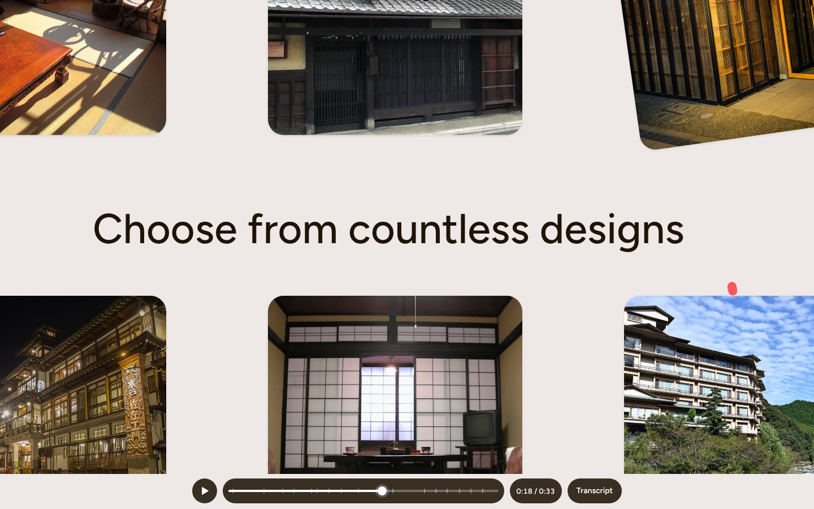

# Booking Story Ad

A 33-second kinetic-type travel ad, rebuilt from a free Jitter template (a booking-app spot whose footer credits *Mocca*), plus the booking UI it advertises, built for real underneath. A ball travels through every scene. It strikes the words *Limited*, *Costly* and *Generic*, swells into the brand circle, becomes the search button, lands on a date, rolls the range out, turns into *Reserve*, and ends as three loading dots and a tick.

The ad is drawn live in HTML and CSS rather than played as a video. Every word is real text, and the brand, destination, dates, guests and listing come from one config block. Plain HTML, CSS and vanilla JS, with no dependencies. Classes are prefixed `ui-bsa` (the ad) and `bk` (the booking UI).

The source ad's brand is replaced by **tomaru** (泊まる, "to stay"), a fictional brand with its own mark: a doorway with the travelling ball inside it. The photos are Creative Commons stand-ins for the source's listing photos (credits below).



## The timeline (measured from the source, frame by frame at 25 fps)

| Time | Scene | What happens |
| --- | --- | --- |
| 0.00 | Words | **Limited** rises out of a blur on coral as a cream streak shoots across. Hard cuts flip coral ↔ cream on every word: **Costly** (0.60), **Generic** (1.00), then **That's · every · hotel.** (1.92 / 2.32 / 2.64). The ball knocks each word down about 22 px and it springs back. |
| 3.96 | Brand | On cream, the coral ball drops to the centre and swells into a circle that floods the screen (4.56–5.08). **[mark] tomaru changed that** drops in part by part, then rises out at 6.13. |
| 6.28 | Giant split | Huge **simple**: a split line rises, with teal type on cream above it and cream type on teal below. The *m* drops in from above and the *p* rises from below until they share a baseline, while the zoom pulls out around the *m*'s right stem. |
| 7.00 | simple | Cream **s i m p l e** on teal, its tracking closing from 18 px to 0 as it settles from 142% to 100%. |
| 7.76 | Scatter | The letters fly apart. A teal pill stretches into the white **Anywhere · Anytime · Add guests** bar, overshooting to 588 px and settling at 504. The coral search button blooms and the coral ball dives into it. |
| 9.28 | Tilt | On grey, the bar tips to −6°, the search button jumps off it and spins its glass, and two cream orbs bob up from below. |
| 10.00 | Destination | **Dest · in · ation** drop in on staggered lines over the full search bar (Where · Check-in · Check-out · Who). |
| 10.70 | Where | The camera dives 3.4× into the bar and pans back to **Where**. A teal panel slides in and *Kyoto, Japan* is typed (11.66). |
| 12.20 | time | The teal sweeps away to reveal a 10× **time**. The word shrinks, the dot of the *i* pops off as a pill, the *e* flips into a schwa, and the letters spring apart. |
| 13.80 | Calendar | **Dates · Months · Flexible**, October 2025. The ink ball falls onto the 6th, knocks the 6 out of its cell and settles as the check-in circle. A second circle rolls the range out to the 10th. |
| 15.96 | Who | The end circle stretches into the **Who** field. **Search** blooms inside it, a cursor hovers and presses it, and *2 guests* is set. A coral drop falls out. |
| 18.24 | Wall | **Choose from countless designs** over a 5 × 4 wall of stays. Two tiles tip, the camera pulls back, then cuts in as one photo pops out and swings down. |
| 20.32 | Listing | Over a faint 京都 (Kyoto), the photo lands as the hero of a listing with two side shots. **Room in Shimogyo Ward, Japan** follows (21.16), then the teal ball turns into **Reserve** and the cursor presses it (22.62). |
| 24.30 | Request sent | **Request sent** rises in and shrinks to 80% (25.00) as a dark panel peeks in from the right. |
| 25.76 | Wait | **and you just wait…**, with *wait* in Braille, French, Korean, Japanese, Polish, Spanish, Chinese, Swedish, Greek, Arabic and Vietnamese drifting in a cloud. |
| 27.20 | Dots | Three loading dots in browns bob while teal balls orbit them, and a teal tick lands (28.68). |
| 28.80 | Confirmed | **Your reservation is confirmed**, settling from 125% to 100%, then *You're going to Japan.* |
| 30.24 | Logo | The mark on coral. |
| 31.68 | End card | An end mark on cream. The source cuts to black at 33.12. This rebuild holds the end card and offers **Replay**. |

The ball's position, length, width and angle in every scene come from a frame-by-frame track of the source (`tracks.js`, about 700 samples). The camera moves were measured on fixed features (the *m*'s stems, the calendar grid, the wall tiles, the listing's hero), and the type sizes on the text's bounding boxes. Laid over the source at the same times, text boxes land within 1–2 px.

## Files

| File | What it is |
| --- | --- |
| `index.html` | The ad (19 scenes), the player controls, the transcript, the booking UI and the shared SVG symbols |
| `style.css` | Tokens, the scenes (all sizes in source px × `--u`), the controls, the transcript and the booking UI |
| `script.js` | The clock, every scene's motion, the camera rigs, the portrait layout, the controls and the transcript. The `CONFIG` block is at the top. |
| `tracks.js` | The ball tracks measured from the source video |
| `booking.js` | The working search bar, date picker, guest stepper, results and Reserve flow |
| `images/*.webp` | 11 photos of Japanese inns, rooms and streets, 1024–1200 px wide (1 MB in total) |
| `preview.png` | The photo wall beat, at 1440 × 900 |

Fonts load from Google Fonts. **Figtree** stands in for the source's rounded geometric sans, **Montserrat** sets *simple*, *Destination* and *time*, and **Noto** families set the multilingual "wait" cloud. Those are loaded as glyph subsets with `text=`, so they cost a few KB.

## Make it yours

Edit `CONFIG` at the top of `script.js`:

```js
var CONFIG = {
  brand: 'tomaru',
  destination: 'Kyoto, Japan',
  country: 'Japan',
  year: 2025, month: 9,          // 0-based: October
  checkIn: 6, checkOut: 10,
  guests: 2,
  listingTitle: 'Room in Shimogyo Ward, Japan',
  listingFacts: '2 guests · 1 bedroom · 2 beds · 1 private bath',
  legal: '©2025 - tomaru - All Rights Reserved.'
};
```

- The calendar is laid out from `year` and `month`. The selection circles land on `checkIn` and `checkOut`. The transcript and the booking UI read the same values.
- **Photos.** Change `PHOTOS` in `script.js`: `onsen` is the listing hero and the photo that pops out of the wall, and `futon` and `bath` are the side shots. The wall's 20 tiles are laid out in `fillContent()`. The booking results use `STAYS` in `booking.js`.
- **Mark.** The mark is the `#ui-bsa-mark` symbol in `index.html` (a 32 × 32 viewBox drawn in `currentColor`).
- **Colours.** These are the `--bsa-*` tokens at the top of `style.css`.
- **Review a moment.** Add `?t=16.4` to the URL to freeze any moment. `?bare=1` hides the controls, and `?autoplay=0` starts paused. `window.UI_BSA.seek(t)`, `.play()` and `.pause()` drive it from code.

## Controls

| Input | Action |
| --- | --- |
| Play / Pause button | Starts or stops the ad. The clock stops exactly. |
| Slider | Scrub to any moment. The ticks mark the beats. |
| ← / → on the slider | One second back or forward |
| Page Up / Page Down | The previous / next beat |
| Home / End | The start / end |
| Space or K on the slider | Play / Pause |
| Transcript times | Jump to that beat and play from there |
| Replay | Shown at the end |

The ad also holds still while it is scrolled out of view or the tab is hidden, and carries on when it comes back.

## Responsive

- **Landscape** (desktops, tablets, phones on their side). The 720 × 400 source frame scales to fit the space above the controls. `--u` is one source pixel.
- **Portrait** (phones). The frame becomes 405 × 720, and each scene scales its composition by its own factor, so type stays large: the opening words, *simple* and *time* keep their full size. On a portrait frame the calendar camera keeps both ends of the date range in view, and the "Request sent" line wraps.
- The booking UI collapses to a two-row search card under 760 px, and the popovers go full width. There is no horizontal scroll at 390 px.

## Accessibility

- **The ad is a picture.** The canvas is `aria-hidden`, and its words are given to assistive tech in three ways: the section's summary, a **Transcript** of every beat (with a short description of what's on screen), and a slider whose `aria-valuetext` names the beat ("0:18 of 0:33, Choose from countless designs."). Seeks the visitor makes are announced through a polite live region. Playback itself stays quiet.
- **It can be stopped.** The ad runs longer than 5 seconds, so it has Pause (WCAG 2.2.2), and a **Skip the ad** link goes straight to the booking UI.
- **Reduced motion.** Nothing moves on its own. The ad rests on the brand beat, and Play lets the visitor opt in.
- **Contrast.** The source's palette was lifted where its text failed:
  - Type on coral is white instead of cream (3.1:1, all large text).
  - Coral type on cream is `#e8474f` (3.2:1, large text).
  - The white labels on the ad's *Search* and *Reserve* buttons, and on the booking UI's buttons, sit on `#d43a43` (4.7:1).
  - Small teal type is `#006a6f` (5.5:1).

  The faint template credit at the foot of the frame is drawn as part of the picture, as the source has it. That is incidental text under WCAG 1.4.3, and the page footer carries the notice at full contrast.
- **The booking UI is a real form.**
  - `role="search"`, with a labelled *Where* input and a datalist.
  - The date and guest pickers are buttons that open non-modal dialogs. Escape or Done closes them and returns focus to the button.
  - The calendar is an ARIA grid with roving focus: arrows move by day and week, Home and End go to the week's ends, and Page Up and Page Down change month. Each day is a toggle button named like "Monday, October 6, 2025, check-in". Past days are disabled.
  - Dates, Months and Flexible are tabs with arrow-key navigation.
  - The guest steppers announce their value, and adding a child adds an adult.
  - The results are announced ("6 stays in Kyoto, Japan, 4 nights, for 2 guests.").
  - *Reserve* walks through *Request sent* to *Confirmed* in a live region.
- Every control is at least 44 × 44 px with a visible focus ring. In forced-colours mode the controls get system borders and the selected days use `Highlight`.
- **Checked with axe-core 4.10** (WCAG 2.2 AA and best practice) at 1280 × 800 and at 390 × 844 with reduced motion, with the date and guest dialogs open and the results showing: no violations.
  - The ad canvas was also checked at 39 moments across all 19 scenes at 720 × 400, 1280 × 800 and 390 × 844. The only flag is a line caught mid-fade at 4.00s.

## Credits

The animation, timing and layout are from a free Jitter template. The brand, mark and copy changes are this repo's. Photos (all resized and re-encoded as WebP):

| File | Photo | Author | Licence |
| --- | --- | --- | --- |
| `01-onsen-street-night.webp` | [Ginzan Onsen Noto-ya Ryokan](https://commons.wikimedia.org/w/index.php?curid=61323268) | Eiji Kikuta | [CC0 1.0](https://creativecommons.org/publicdomain/zero/1.0/) |
| `02-garden-room-dusk.webp` | [Traditional Room](https://www.flickr.com/photos/136749227@N06/22239451949) | nishimuraya.kinosakionsen | [CC BY 2.0](https://creativecommons.org/licenses/by/2.0/) |
| `03-tatami-shoji.webp` | [Tea Setting](https://www.flickr.com/photos/44124372247@N01/743117938) | objectfox | [CC BY 2.0](https://creativecommons.org/licenses/by/2.0/) |
| `04-ryokan-hillside.webp` | [Otani Sanso ryokan](https://commons.wikimedia.org/w/index.php?curid=59586147) | Raita Futo | [CC BY 2.0](https://creativecommons.org/licenses/by/2.0/) |
| `05-lantern-entrance.webp` | [A Modern Twist on Traditional Japanese Architecture in Kanazawa](https://www.flickr.com/photos/91873384@N04/54381298293) | dalecruse | [CC BY 2.0](https://creativecommons.org/licenses/by/2.0/) |
| `06-sunlit-tatami.webp` | [Day 6: Tsuwano](https://www.flickr.com/photos/39952962@N00/3129263060) | decade_null | [CC BY 2.0](https://creativecommons.org/licenses/by/2.0/) |
| `07-garden-window.webp` | [View from my room, Aoi-so Inn, Kyoto](https://www.flickr.com/photos/91625368@N00/9847310034) | espenore | [CC BY 2.0](https://creativecommons.org/licenses/by/2.0/) |
| `08-gion-rain.webp` | [gion district](https://www.flickr.com/photos/67162482@N07/6122839290) | David Offf | [CC BY 2.0](https://creativecommons.org/licenses/by/2.0/) |
| `09-machiya.webp` | [Aburanokoji-dori Hata-ke House](https://www.flickr.com/photos/64855052@N00/3892329400) | gintacat | [CC BY 2.0](https://creativecommons.org/licenses/by/2.0/) |
| `10-futon-room.webp` | [Homeikan Honkan Ryokan](https://commons.wikimedia.org/w/index.php?curid=14526106) | Deborah Austin | [CC BY 2.0](https://creativecommons.org/licenses/by/2.0/) |
| `11-cedar-bath.webp` | [Private Onsen Bath in our suite](https://www.flickr.com/photos/89060048@N03/11652130443) | City Foodsters | [CC BY 2.0](https://creativecommons.org/licenses/by/2.0/) |

The page lists the same credits under **Photo credits** in its footer.
