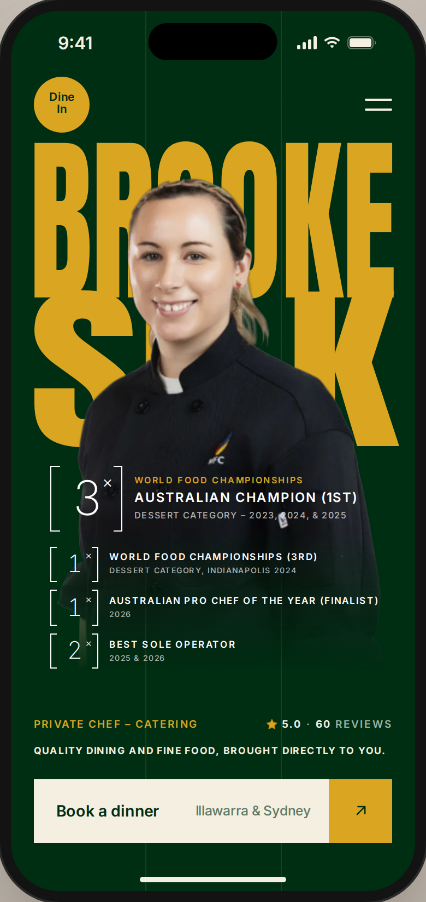
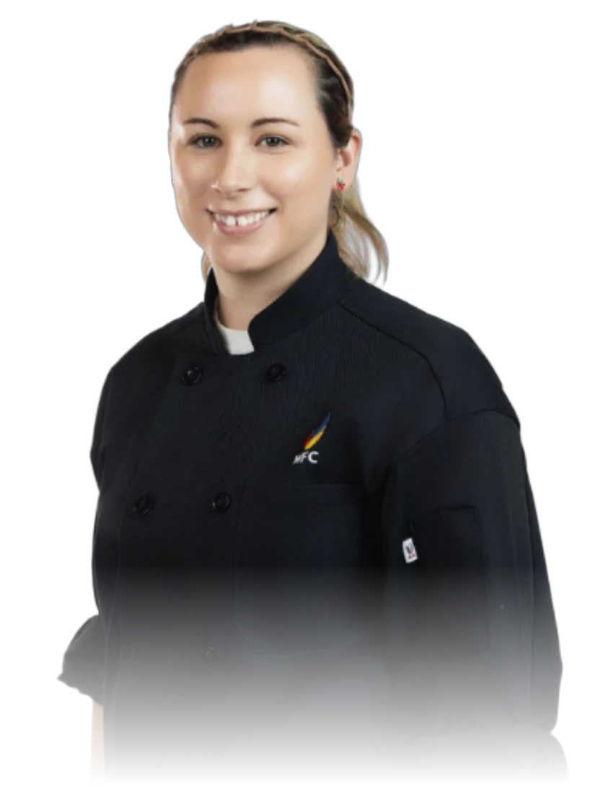

# Chef Card

The Dine In edition of the [profile card](../profile-card/), for private chef Brooke Silk. It has the same layout and intro, rebranded in Dine In's green and gold: "BROOKE / SILK" in gold on Dine In green, her cut-out portrait in front of the name, her four awards stacked on her chef's jacket, and a tagline and split "Book a dinner" button below.



- **Layout** (top to bottom):
  - Top bar: a round gold monogram ("Dine In") on the left, a two-line ivory menu button on the right.
  - Name: "BROOKE / SILK" in gold, each line stretched to the full width. The lines touch, and the portrait covers their middle.
  - Portrait: Brooke from the head to just below the pocket, in her black chef's jacket. It fades into the green around the hem.
  - Awards: four bracketed stats stacked in white on the jacket, each with a title and a smaller detail line:
    - **Lead award**, larger and on three lines: `[3×]` World Food Championships (a small gold line), Australian Champion (1st), dessert category – 2023, 2024, & 2025
    - `[1×]` World Food Championships (3rd): dessert category, Indianapolis 2024
    - `[1×]` Australian Pro Chef of the Year (Finalist): 2026
    - `[2×]` Best Sole Operator: 2025 & 2026

    The bracket shows how many times, and the placing sits in brackets after the title. The lead award has a bigger bracket and title, so it stands out from the three smaller ones below it.
  - Meta row: "Private chef – Catering" in gold on the left, and her Google rating (★ 5.0 · 60 reviews) on the right.
  - Tagline: "Quality dining and fine food, brought directly to you." in tracked ivory uppercase, on one line. It's sized to fit the full width of the card, so a longer tagline needs a smaller `font-size` on `.ui-chef__tagline`.
  - Button: an ivory bar with "Book a dinner" and the service area "Illawarra & Sydney", plus a gold square with an arrow.
- **Grid:** two faint gold hairlines divide the card into thirds, behind everything.
- **Colours:** Dine In green `#002E13` and gold `#DAA520`, both taken from the Dine In logo, with a warm ivory `#F4EFE1` for text and the button.
- **Intro:** the same as the profile card, played the first time the card scrolls into view. Until their turn, the stat, meta row, tagline and button show as skeleton bars in a faint ivory tint.
  1. The name types out letter by letter (BROOKE, a short pause, then SILK) behind a blinking gold caret.
  2. As the last letter lands, the portrait opens out from the centre of the face.
  3. The information then loads one row at a time:
     - the lead award on its own: it drops in slightly larger, settles with a small bounce and counts 0 → 3×
     - after a short hold, the other three awards, 0.1s apart, each counting up as it fills in (1×, 1×, 2×)
     - after a short pause, the meta row: ★ 0.0 → 5.0 and 0 → 60 reviews. When the rating reaches 5.0, gold sparkles fly into the star, and it jumps, turns gold and stays gold.
     - after a short pause, the tagline
     - after another short pause, the button

  The whole intro takes about 7 seconds, and `window.uiChef.play(card)` replays it. The demo has a "Replay intro" button.
- **Hover:** hovering the monogram tilts it, hovering the menu shortens its bottom line, and hovering the button nudges the arrow out to the top right.
- **Reduced motion, or no JavaScript:** the card shows at rest with the final numbers and a gold star.
- **Scaling:** every size comes from the card's width (390 design units, using container query units), so the whole layout scales as one piece from a 320px phone up to the 430px max width.

Plain HTML, CSS and vanilla JS, no dependencies. Classes are prefixed `ui-chef`, so this card and the profile card can sit on the same page. Open `index.html` for the demo, which shows the card in a phone frame.

## Files

| File | What it is |
| --- | --- |
| `index.html` | Demo page: the card inside a phone frame with a status bar |
| `style.css` | Component styles, including the intro states |
| `script.js` | The intro: typewriter name, portrait reveal and count-ups |
| `images/brooke-silk.webp` | Transparent portrait cut-out that fades out at the bottom (818 × 1118) |
| `preview.png` | Screenshot of the demo |

## Markup

```html
<article class="ui-chef" data-ui-chef>
  <div class="ui-chef__inner">
    <span class="ui-chef__grid" aria-hidden="true"></span>

    <header class="ui-chef__bar">
      <a class="ui-chef__mark" href="#">Dine<br>In</a>
      <button class="ui-chef__menu" type="button" aria-label="Menu">
        <span></span><span></span>
      </button>
    </header>

    <h2 class="ui-chef__name">
      <svg viewBox="0 0 390 296" aria-hidden="true" focusable="false">
        <text x="18" y="149" textLength="354" lengthAdjust="spacingAndGlyphs">BROOKE</text>
        <text x="18" y="292" textLength="354" lengthAdjust="spacingAndGlyphs">SILK</text>
        <rect class="ui-chef__caret" x="18" y="0" width="7" height="149"/>
      </svg>
      <span class="ui-chef__sr">Brooke Silk</span>
    </h2>

    <figure class="ui-chef__media">
      
    </figure>

    <ul class="ui-chef__stats" data-ui-chef-stagger="100" aria-label="Awards">
      <li class="ui-chef__stat ui-chef__stat--lead">
        <span class="ui-chef__stat-num"><span data-ui-chef-count>3</span><sup>×</sup></span>
        <span class="ui-chef__stat-label"><span class="ui-chef__stat-kicker">World Food Championships</span><span>Australian Champion (1st)</span><span class="ui-chef__stat-sub">Dessert category – 2023, 2024, &amp; 2025</span></span>
      </li>
      <li class="ui-chef__stat" data-ui-chef-pause="600">
        <span class="ui-chef__stat-num"><span data-ui-chef-count>1</span><sup>×</sup></span>
        <span class="ui-chef__stat-label"><span>World Food Championships (3rd)</span><span class="ui-chef__stat-sub">Dessert category, Indianapolis 2024</span></span>
      </li>
      <li class="ui-chef__stat" data-ui-chef-join>
        <span class="ui-chef__stat-num"><span data-ui-chef-count>1</span><sup>×</sup></span>
        <span class="ui-chef__stat-label"><span>Australian Pro Chef of the Year (Finalist)</span><span class="ui-chef__stat-sub">2026</span></span>
      </li>
      <li class="ui-chef__stat" data-ui-chef-join>
        <span class="ui-chef__stat-num"><span data-ui-chef-count>2</span><sup>×</sup></span>
        <span class="ui-chef__stat-label"><span>Best Sole Operator</span><span class="ui-chef__stat-sub">2025 &amp; 2026</span></span>
      </li>
    </ul>

    <div class="ui-chef__body">
      <p class="ui-chef__meta" data-ui-chef-pause="300">
        <span class="ui-chef__role">Private chef – Catering</span>
        <span class="ui-chef__proof"><b><svg class="ui-chef__star" viewBox="0 0 24 24" aria-hidden="true" focusable="false"><path d="M12 2.8l2.85 5.8 6.4.93-4.63 4.5 1.1 6.37L12 17.4l-5.72 3l1.1-6.37-4.63-4.5 6.4-.93z"/></svg><span class="ui-chef__sr">Rated </span><span data-ui-chef-count>5.0</span></b> · <b data-ui-chef-count>60</b> reviews</span>
      </p>
      <p class="ui-chef__tagline" data-ui-chef-pause="200"><span>Quality dining and fine food, brought directly to you.</span></p>
      <a class="ui-chef__cta" href="#book" data-ui-chef-pause="200">
        <span class="ui-chef__cta-label">
          Book a dinner
          <span class="ui-chef__cta-note">Illawarra &amp; Sydney</span>
        </span>
        <span class="ui-chef__cta-arrow" aria-hidden="true">
          <svg viewBox="0 0 24 24"><path d="M7 17L17 7M8 7h9v9"/></svg>
        </span>
      </a>
    </div>
  </div>
</article>
<script src="script.js"></script>
```

The awards are a list (`ui-chef__stats`). Each `ui-chef__stat` has a bracketed number and a label with a title and a `ui-chef__stat-sub` detail line. Add `ui-chef__stat--lead` to make one the lead award: its bracket, number and title are larger, and it can take a small gold `ui-chef__stat-kicker` line above the title. Every award's sizes come from a few custom properties on `.ui-chef__stat` (`--num-w`, `--num-h`, `--num-size`, `--sup-size`, `--arm`, `--title-size` and `--sub-size`, in design units). The lead class overrides them. A `<sup>` after the number (×) sits top right, and a `<sup class="ui-chef__stat-pre">` before it (for example "Top") sits top left. None of the current awards uses it. The number then drops and shrinks a little to clear it, so two digits fit. In the intro, each award is its own row. The second award has `data-ui-chef-pause="600"`, so it waits after the lead has counted. The third and fourth have `data-ui-chef-join`, so they load in the same step as the second, offset by the list's `data-ui-chef-stagger="100"` (ms). Four awards fit on the jacket; for more, raise the list's `top` or tighten its `gap`.

The caret is the `ui-chef__caret` rect inside the name's SVG. Mark any number that should count with `data-ui-chef-count`, as in `<span data-ui-chef-count>2</span><sup>×</sup>`. The number written in the HTML is the one it ends on, and the one shown without the script. It counts up from 0 unless `data-ui-chef-count-from` gives another start. A start above the final number makes it count down, so a price like `from $<span data-ui-chef-count data-ui-chef-count-from="100">60</span>` counts down to 60. To add a short pause before a row loads, put `data-ui-chef-pause` on it with a time in milliseconds. The meta row uses `data-ui-chef-pause="300"`, and the tagline and button each use `200`.

**Changing the name:** edit the two `<text>` lines and the hidden `ui-chef__sr` text. `textLength` stretches each line to the full width, whatever its length, so a short name gets wide letters and a long one gets narrow letters. Names of 4–6 letters per line look best.

## Theming

Colours and fonts are custom properties on `.ui-chef`:

| Property | Default | What it does |
| --- | --- | --- |
| `--ui-chef-accent` | `#DAA520` | Dine In gold: name, monogram, role and arrow tile |
| `--ui-chef-on-accent` | `#002E13` | Monogram text |
| `--ui-chef-bg` | `#002E13` | Dine In green page |
| `--ui-chef-grid` | gold at 14% | The two column hairlines |
| `--ui-chef-ink` | `#F4EFE1` | Ivory: tagline, menu, numbers and button |
| `--ui-chef-muted` | `#9DB3A2` | "reviews" in the meta row |
| `--ui-chef-cta-fg` | `#002E13` | Button label and arrow |
| `--ui-chef-cta-note` | `#5E7A66` | "Illawarra & Sydney" |
| `--ui-chef-gold` | `#DAA520` | Rating star fill and the sparkles |
| `--ui-chef-gold-edge` | `#B8860B` | Rating star outline |
| `--ui-chef-skel` | ivory at 8% | Skeleton bars during the intro |
| `--ui-chef-skel-shine` | ivory at 10% | The shine that sweeps across them |
| `--ui-chef-display` | Anton | Typeface for the name |
| `--ui-chef-font` | Inter | Typeface for everything else |
| `--ui-chef-radius` | `0` | Corner radius in design units |
| `--ui-chef-inset-top` | `0px` | Extra top padding when the card sits under a status bar |

The demo loads Anton and Inter from Google Fonts.

## Portrait

`images/brooke-silk.webp` is cut out of Brooke's studio photo, framed from the top of her head to below the jacket pocket, with the bottom ~30% faded to transparent. To use another photo:

- export a transparent PNG/WebP, about 820 × 1120 or larger
- frame it from the top of the head to about the waist
- fade the bottom ~30% to transparent

If the aspect ratio is different, update `aspect-ratio` on `.ui-chef__media`. Then nudge its `top` so the head starts about a fifth of the way down the first line of the name.
