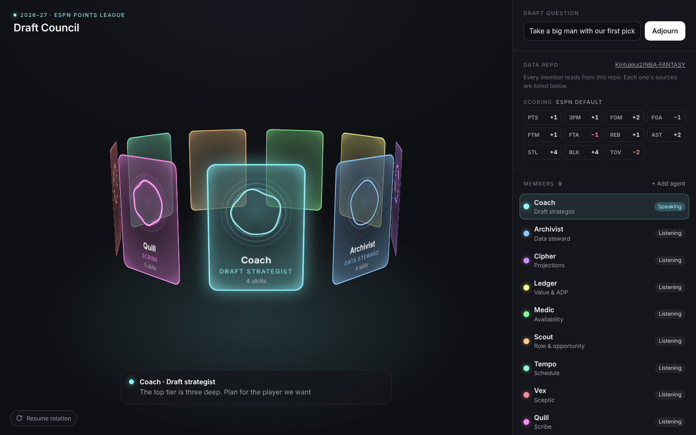

# Draft Council

The [AI Council](../ai-council/) set up as a draft companion for an ESPN fantasy basketball points league. Nine personas sit on the ring. Each has a **role**, the **skills** it uses and the **data** it reads, and all of them point at one data repo: [Kintukka2/NBA-FANTASY](https://github.com/Kintukka2/NBA-FANTASY).

Plain HTML, CSS and vanilla JS, with no dependencies. It is built on the same classes and orb renderer as AI Council (`ui-council`).



## The personas

Every persona follows the same framework: **name, role, skills to use, and the paths it reads in the data repo.**

| Persona | Role | What they do in the draft | Skills | Reads from the repo |
| --- | --- | --- | --- | --- |
| **Coach** | Draft strategist (chair) | Frames each pick against the league settings and draft slot, calls on the right members, then makes the call | `analysis-planning`, `stakeholder-requirements-gathering`, `insight-synthesis`, `executive-summary-generator` | `league/settings.yaml`, `analysis/` |
| **Archivist** | Data steward | Checks every file before anyone uses it, reconciles ESPN against other sources, keeps the data dictionary, hands out context packs | `programmatic-eda`, `data-quality-audit`, `schema-mapper`, `metric-reconciliation`, `data-catalog-entry`, `context-packager` | `data/raw/`, `data/clean/`, `docs/data-dictionary.md` |
| **Cipher** | Projections | Projects ESPN fantasy points per game and per season, as a range | `data:statistical-analysis`, `time-series-analysis`, `semantic-model-builder`, `methodology-explainer` | `data/clean/game_logs/`, `league/settings.yaml`, `analysis/projections.csv` |
| **Ledger** | Value & ADP | Points over replacement by position, tiers, and players going too early or too late against ESPN's ADP | `segmentation-analysis`, `impact-quantification`, `data:analyze` | `analysis/projections.csv`, `data/clean/adp/`, `analysis/tiers.csv` |
| **Medic** | Availability | Expected games played from injury history, age and rest patterns, plus current injury news | `cohort-analysis`, `root-cause-investigation`, `deep-research` | `data/clean/injuries/`, `data/clean/game_logs/` |
| **Scout** | Role & opportunity | Minutes, usage, team changes and rookies. Uses with/without-teammate splits to size each change | `deep-research`, `research`, `ab-test-analysis`, `data:explore-data` | `data/clean/depth_charts/`, `data/clean/transactions/`, `data/clean/game_logs/` |
| **Tempo** | Schedule | Games per fantasy week, back-to-backs and the fantasy playoff weeks, as a tiebreaker | `data:write-query`, `query-validation`, `visualization-builder` | `data/clean/schedule/`, `league/settings.yaml` |
| **Vex** | Sceptic | Challenges every pick, logs the assumptions behind it, and describes how it busts | `grilling`, `analysis-assumptions-log`, `analysis-qa-checklist`, `peer-review-template` | `analysis/`, `docs/assumptions.md` |
| **Quill** | Scribe | Keeps the ranked cheat sheet and live draft board, and writes up each pick with its reasons | `xlsx`, `dataviz`, `dashboard-specification`, `data:build-dashboard`, `data-narrative-builder` | `analysis/`, `board/draft_board.xlsx` |

### Why these skills

Most of the skills come from the data-analytics skills pack, the same 31 skills as the `data-analytics-skills-main.zip` uploaded to the NBA-FANTASY repo. The rest are the `data:` plugin skills (`data:analyze`, `data:statistical-analysis` and others), plus `xlsx`, `dataviz`, `deep-research`, `research` and `grilling`. A few are repurposed for basketball:

- `ab-test-analysis` lets Scout compare a player's output with and without a teammate on the floor, which is a split test like any other.
- `cohort-analysis` lets Medic compare games played across groups of similar players, such as age bands or players coming back from the same injury.
- `segmentation-analysis` builds Ledger's tiers. Players in a tier are close enough in value to swap.
- `semantic-model-builder` lets Cipher define the fantasy points formula once, so every member uses the same one.
- `metric-reconciliation` catches ESPN numbers that disagree with other sources before they reach the board.

Some skills in the pack don't fit a draft and are left out: `funnel-analysis` and the SaaS metrics in `business-metrics-calculator`. You can still add any skill to any persona from the panel.

In this Claude Code environment the pack's skills are named with an `anthropic-skills:` prefix, for example `anthropic-skills:programmatic-eda`. The panel shows the short names.

## Connected to NBA-FANTASY

The personas are wired to the real repo. `PRESETS` in `script.js` mirrors
[`council/members.json`](https://github.com/Kintukka2/NBA-FANTASY/blob/main/council/members.json),
which is the single source of truth for every member's role, skills,
sources and vote weight. Every member reviews two folders, `docs/` and `data/`:

| Persona | Starts from |
| --- | --- |
| Coach | `docs/league-rules.md`, `docs/scoring.md`, `data/raw/league_settings.csv` |
| Archivist | `docs/data-dictionary.md`, `docs/methodology.md`, `data/raw/`, `data/processed/verification.csv` |
| Cipher | `data/processed/players_scored.csv`, `data/raw/actuals_2026.csv`, `data/raw/projections_2027.csv` |
| Ledger | `data/processed/players_scored.csv` (ADP against league-scored points), `docs/offseason-impact.md` |
| Medic | `docs/offseason-impact.md` §1 injury board, `Injury`, `A_GP`, `P_GP` |
| Scout | `docs/offseason-impact.md` §2–§7 |
| Tempo | `docs/league-rules.md` roster, waivers and playoffs (renamed **Roster & schedule**: the repo has no schedule file) |
| Vex | the known traps in every doc, §7 unresolved, Appendix A |
| Quill | `council/sessions/`, the council's own record |

### Asking the council

Real deliberation runs in Claude Code, inside NBA-FANTASY:

```
/council Clingan or Sengun with pick 24?
```

Nine subagents (`.claude/agents/council-*.md`) research the two folders in
parallel and each returns a ballot: vote, confidence, rationale, evidence.
A question can be **yes/no**, a **selection** between named options, or an
open **suggestion**, where the proposals are pooled and everyone votes again.
`council/tally.py` counts by vote weight. If no option has a majority, the
top two go to a runoff, and the highest-voted answer is the verdict. See
`council/PROTOCOL.md` in that repo.

### Replaying a session on the ring

Each session is saved as JSON in NBA-FANTASY `council/sessions/`. Press
**Replay a session…** (or drop the file on the page, or open
`index.html?session=<url-to-the-json>`). Each member thinks, swings to the
front and speaks its real vote and rationale, round by round. The panel then
shows the real tally and the verdict. `Council.replay(session)` does the same
from code.

## What's on screen

Everything from [AI Council](../ai-council/) works the same way: the ring, the five orb states, the speaking card rising and glowing, drag and keyboard, Convene, the weighted vote, adding and removing members, and saving edits in the browser. This version adds:

- **Draft question** replaces Motion. The default is "Take a big man with our first pick". The scripted lines talk about tiers, ADP, games played and four-point steals and blocks. They don't name or rate real players.
- **Data repo** links to NBA-FANTASY. **Scoring** shows the ESPN weights.
- **Skills** for the selected member are listed as chips. Remove one with ×, or add one from the catalogue with **+ Add a skill**. Each card shows how many skills that member has.
- **Reads from the repo** lists the member's paths, one per line.
- **Persona pack** writes the member out as instructions: brief, skills, repo and paths, scoring, lean and vote weight. **Copy pack** copies it, ready to paste into an agent's instructions.

## Plug in real agents

`window.Council` works the same as in [AI Council](../ai-council/#plug-in-real-agents), with a few additions:

| Call | What it does |
| --- | --- |
| `Council.pack(id)` | The member's persona pack, as Markdown |
| `Council.repo` | `{ name, url }` of the data repo |
| `Council.scoring` | The scoring weights, as `[stat, points]` pairs |
| `Council.skills` | The skills catalogue |
| `Council.get(id)` | Now includes `skills` and `sources` |
| `Council.replay(session)` | Plays a saved NBA-FANTASY council session on the ring and shows its real tally |

A real run sends each member's `Council.pack(id)` as its instructions, with the draft question as the prompt. It sets the member to `thinking` while the request runs, `speaking` while the answer streams into `Council.say(id, text)`, then back to `listening`.

## Files

| File | What it is |
| --- | --- |
| `index.html` | The stage, the floor caption and the side panel |
| `style.css` | AI Council's styles, plus the scoring grid, skill chips and persona pack |
| `script.js` | The personas, skills catalogue, scoring and data repo, on top of AI Council's ring, orbs, panel and API |
| `preview.png` | A still at 1440 × 900, mid-session |
