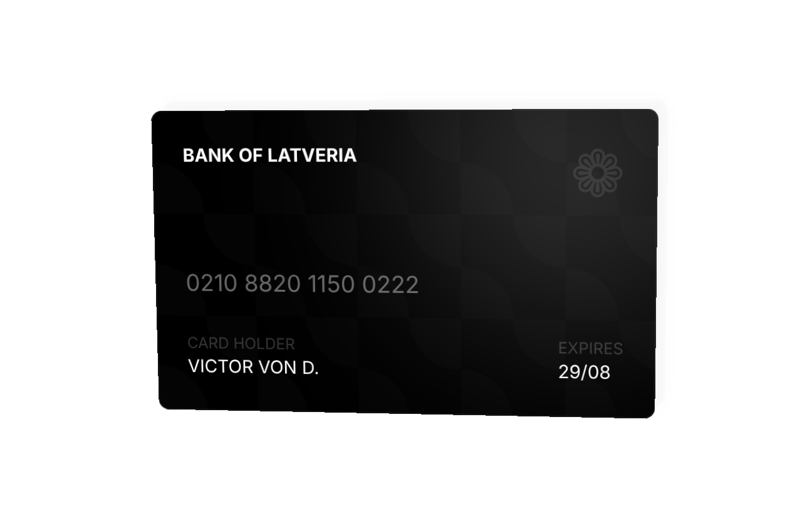

# Hover 3D Card

daisyUI's `hover-3d` effect wrapped around a black credit card: the card tilts toward the pointer in 3D and a soft light follows it across the surface.



- **3D tilt:** `hover-3d` on the `<a>` splits the card into eight invisible hover zones (the eight empty `<div>`s after the content). The zone under the pointer sets the tilt and moves the glare.
- **Pattern:** two offset `radial-gradient`s at `#ffffff04`, tiled with `bg-size-[4.95em_4.95em]`, make the faint scalloped texture on the black card.
- **Layout:** bank name and a faded ❁ mark across the top, the card number at 40% opacity, then holder and expiry with 20% opacity labels.

## Use it

Load daisyUI 5 and Tailwind CSS 4, then copy the card:

```html
<link href="https://cdn.jsdelivr.net/npm/daisyui@5" rel="stylesheet" type="text/css" />
<script src="https://cdn.jsdelivr.net/npm/@tailwindcss/browser@4"></script>
```

```html
<a href="#" class="hover-3d my-12 mx-2 cursor-pointer">
  
  <!-- content -->
  <div class="card w-96 bg-black text-white bg-[radial-gradient(circle_at_bottom_left,#ffffff04_35%,transparent_36%),radial-gradient(circle_at_top_right,#ffffff04_35%,transparent_36%)] bg-size-[4.95em_4.95em]">
    <div class="card-body">
      <div class="flex justify-between mb-10">
        <div class="font-bold">BANK OF LATVERIA</div>
        <div class="text-5xl opacity-10">❁</div>
      </div>
      <div class="text-lg mb-4 opacity-40">0210 8820 1150 0222</div>
      <div class="flex justify-between">
        <div>
          <div class="text-xs opacity-20">CARD HOLDER</div>
          <div>VICTOR VON D.</div>
        </div>
        <div>
          <div class="text-xs opacity-20">EXPIRES</div>
          <div>29/08</div>
        </div>
      </div>
    </div>
  </div>
  
  <!-- 8 empty divs needed for the 3D effect -->
  <div></div>
  <div></div>
  <div></div>
  <div></div>
  <div></div>
  <div></div>
  <div></div>
  <div></div>
</a>
```

Keep all eight empty `<div>`s: removing any of them breaks the tilt for that part of the card. Change `href="#"` to point the card somewhere real.
