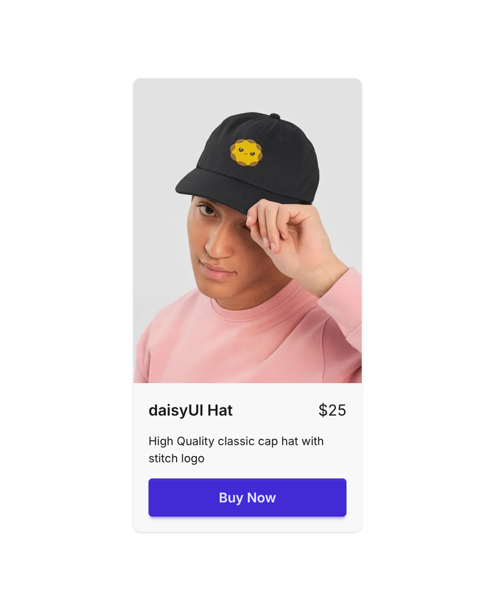

# Hover Gallery Card

daisyUI's "Hover gallery in a card" with two additions: text that never leaves a single word alone on the last line, and a full-width **Buy Now** button.



- **Hover gallery:** move the pointer across the photo and it steps through four shots of the hat (daisyUI's `hover-gallery`).
- **Pretty wrap:** the title and description use `text-pretty` (`text-wrap: pretty`), so "High Quality classic cap hat with stitch logo" breaks as "…with / stitch logo" instead of leaving "logo" on its own row. Browsers without `text-wrap: pretty` get `text-balance` through `not-supports-[text-wrap:pretty]:text-balance`, which also keeps the last line from holding one word.
- **Buy Now:** a `btn btn-primary btn-block` in `card-actions`, the full width of the card body.
- **Spacing:** `card-body gap-3` puts an even 12px between the title row, the description and the button. The title row uses `items-baseline` and `gap-4` so a long name wraps without touching the price, and the price has `shrink-0` so it never wraps.

## Use it

Load daisyUI 5 and Tailwind CSS 4, then copy the card:

```html
<link href="https://cdn.jsdelivr.net/npm/daisyui@5" rel="stylesheet" type="text/css" />
<script src="https://cdn.jsdelivr.net/npm/@tailwindcss/browser@4"></script>
```

```html
<div class="card card-sm bg-base-200 max-w-60 shadow">
  <figure class="hover-gallery">
    
    
    
    
  </figure>
  <div class="card-body gap-3">
    <h2 class="card-title flex items-baseline justify-between gap-4">
      <span class="text-pretty not-supports-[text-wrap:pretty]:text-balance">daisyUI Hat</span>
      <span class="font-normal shrink-0">$25</span>
    </h2>
    <p class="text-pretty not-supports-[text-wrap:pretty]:text-balance">High Quality classic cap hat with stitch logo</p>
    <div class="card-actions">
      <button class="btn btn-primary btn-block">Buy Now</button>
    </div>
  </div>
</div>
```

Swap `<button>` for `<a href="…" class="btn btn-primary btn-block">` to link straight to checkout.
