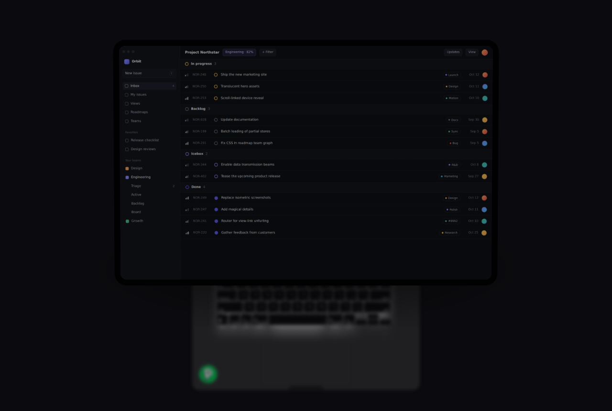

# MacBook Scroll

A rebuild of Aceternity's `MacbookScroll`. As you scroll, the screen ejects from the laptop and lands full-size in the middle of the viewport, and the laptop drops out of focus behind it.



## What changed from the original

- **The section pins.** The laptop sits in a sticky, full-height stage, so the screen lands centred in the viewport and holds there before the page carries on. Before, it slid down the page on a straight 0→1500px translate and never settled.
- **The eject is one continuous move.** The screen unseats from the lid with a small lift and pop, stands up early in the flight, and travels and grows on a single ease-in-out. Before, the rotation snapped flat between 10% and 30% while the translate stayed linear, and the scale was split into separate X and Y values.
- **The laptop gets out of the way.** Across the flight it fades on an ease-in, so it lingers and then goes. It also shrinks to 86%, drops 70px and blurs up to 8px, like a camera pulling focus to the screen. The empty lid shows a short afterglow where the screen left it.
- **The landing has weight.** When the screen arrives it overshoots slightly and settles (1 → 1.035 → 0.992 → 1), a ring pulses out from the bezel, a sheen sweeps across the glass, and an indigo halo flashes and then stays on. The screen is dimmed 35% while it flies and lights up on landing. These effects run on a timer, not on scroll, so they hit the same whatever the scroll speed, and they replay if you scroll back up and land again.
- **Scroll is smoothed** through a spring, so wheel steps don't stutter.
- **Size comes from the viewport.** The laptop scales down to fit any screen, which replaces the old `scale-[0.35] sm:scale-50` and the `isMobile` check. The landed screen is as large as the viewport allows, up to 1280px wide.
- **Cleanup:** the keyboard is built from row data instead of about 80 hand-written `KBtn`s, the function-row icons are inline SVG (`@tabler/icons-react` is no longer needed), `will-change: transform` is gone from every key, and the lid no longer shows a logo on what is actually the display.
- **Reduced motion:** with `prefers-reduced-motion: reduce` the section shrinks to one screen and shows the laptop still.

## Files

| File | |
| --- | --- |
| `MacbookScroll.jsx` | The component. Drop it in as `components/ui/macbook-scroll.jsx`. Needs `react`, `motion` (`motion/react`) and Tailwind. |
| `MacbookScrollDemo.jsx` | Your demo, cleaned up. |
| `index.html` | Preview page: open it in a browser. Loads React 18, Motion and Tailwind from CDNs, then `script.js`. |
| `script.js` | Generated from the two `.jsx` files by `build.mjs` (`npm i -D esbuild && node build.mjs`). Do not edit by hand. |
| `images/screen.webp` | A placeholder app screenshot for the preview. |

## Usage

```jsx
import { MacbookScroll } from "@/components/ui/macbook-scroll";

<div className="w-full overflow-clip bg-white dark:bg-[#0B0B0F]">
  <MacbookScroll
    title={<span>This Macbook is built with Tailwindcss. <br /> No kidding.</span>}
    badge={<a href="https://peerlist.io/manuarora"><Badge className="h-10 w-10 -rotate-12" /></a>}
    src="/linear.webp"
  />
</div>
```

Use `overflow-clip` on the wrapper, not `overflow-hidden`. An `overflow: hidden` ancestor becomes a scroll container, and then the sticky stage never pins.

## Props

| Prop | Type | Default | |
| --- | --- | --- | --- |
| `src` | string | — | Screen image, cropped from the top left to fit 16:10 |
| `alt` | string | `""` | Alt text for the screen image |
| `children` | node | — | Render live content on the screen instead of `src` |
| `title` | node | "This Macbook is built with Tailwindcss. No kidding." | Headline above the laptop |
| `badge` | node | — | Sits in the bottom-left corner of the laptop base |
| `showGradient` | boolean | `false` | Fades the bottom of the base into the page background |
| `className` | string | `""` | Added to the outer `<section>` |

## Tuning

All the timing is in the `PHASE` table at the top of `MacbookScroll.jsx`, as fractions of the pinned scroll. The section is `h-[400vh]`, which gives three screens of scroll. The screen lands at 52%; the rest of the scroll is a hold on the landed screen. To make the hold longer, raise the section height. To make the flight faster or slower, move `flight` and `land` together.
