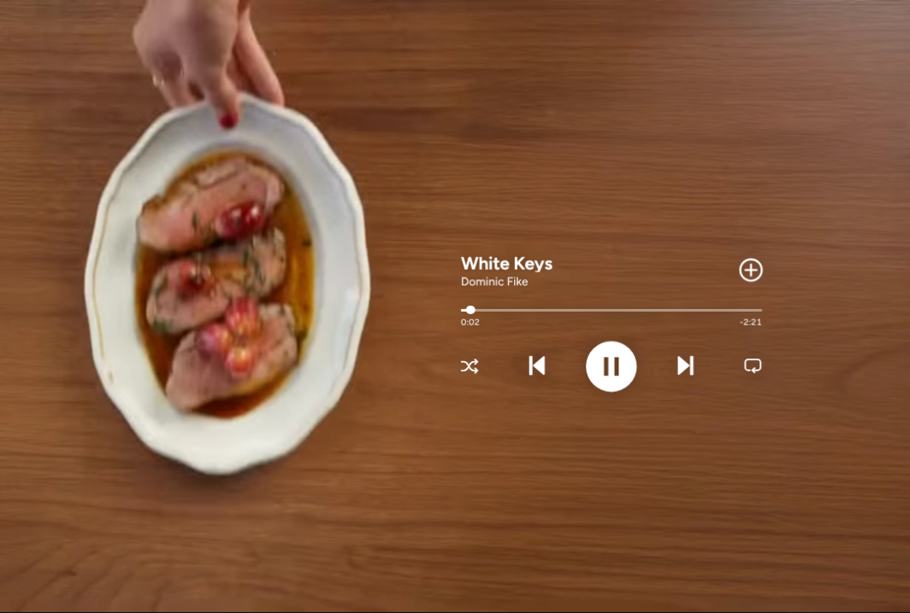

# Now Playing ad

A 10-second, music-led video ad rebuilt from Jitter's free restaurant template, set up as a template you can reuse with other music and scenes. Eleven hard cuts land on the beat under a now-playing overlay, then the frame clears for the logo. Every piece is an editable asset: the scenes are separate clips, the player is HTML and SVG, the logo is a vector, and one JSON block in `index.html` sets the timing.



## The timeline (from the source, frame by frame at 25fps)

| Time | What happens |
| --- | --- |
| 0.00 | A shaker pours a red cocktail over ice |
| 0.48 | Cut: a grapefruit wedge goes into the glass |
| 0.88 | The player hard-cuts in (no fade): **White Keys**, Dominic Fike, `0:00` and `-2:23` |
| 1.36 | Cut: crudo on a walnut table. From here the cuts follow the beat, about every 0.73s (two beats at 164 BPM) |
| 2.16 / 2.80 / 3.56 / 4.28 / 5.04 / 5.80 / 6.44 | Cuts: stove, duck, highball, wine, bartender, terrace, ragu |
| 7.20 | Cut: fresh pasta extruding from a bronze die, held to the end |
| 8.60 | The player hard-cuts out |
| 9.04 | The **AVIA** logo hard-cuts in, right of centre |
| 10.08 | End. It holds on the logo, or loops when Repeat is on |

The player's counter runs on real time. It shows `0:00` at 0.88s and reaches `0:08 / -2:15` at the cut-out, and the knob creeps along the rail.

## Files

| File | What it is |
| --- | --- |
| `index.html` | The ad, the controls bar, the Customise dialog, and the **config block** that defines the ad |
| `style.css` | The frame and the player, measured on the 1064 × 718 source. Also the square and story layouts, the toolbar and the editor |
| `script.js` | The clock, scene sync, the working player controls, the layouts, and the editor |
| `scenes/NN-name.mp4` / `.webm` / `.webp` | The 11 shots as separate clips: H.264 MP4, VP9 WebM, and a first-frame poster (1.8 MB in total) |
| `images/avia-logo.svg` | The logo, traced to a vector from the source (one path, white) |
| `preview.png` | The frame at 3.0s |

**How the assets were made.** The source video has the player and logo baked in, so each shot was cleaned before it was split out:
- A mask was built from the pixels that stay white across every frame the overlay shows, plus the rail, the moving knob, the changing times and the pause disc.
- Each frame was inpainted under that mask, and the logo area was cleaned the same way.
- The logo itself was pulled out as an alpha matte (original frame minus clean frame) and traced to Bézier curves with potrace.

The original soundtrack is **not** included, because the song is copyrighted. Add your own audio file in the config, or load one in Customise.

## Make a new ad

Edit the `<script type="application/json" id="ui-npad-config">` block at the bottom of `index.html`:

```json
{
  "duration": 10.08,
  "loop": false,
  "bpm": 164.4, "beats": 2, "beatOffset": 1.36,
  "player": { "in": 0.88, "out": 8.6 },
  "logo":   { "in": 9.04, "src": "images/avia-logo.svg", "label": "AVIA", "text": "" },
  "track":  { "title": "White Keys", "artist": "Dominic Fike", "length": 144, "start": -0.4, "audio": "" },
  "scenes": [
    { "at": 0, "src": "scenes/01-shaker.mp4", "webm": "scenes/01-shaker.webm", "poster": "scenes/01-shaker.webp", "focus": "18% 50%", "alt": "A shaker pours a red cocktail over ice" }
  ]
}
```

- **Scenes:** `at` is when the shot cuts in. It runs until the next shot's `at`. `src` can be a video or a still image. Other optional fields:
  - `webm`: a second encoding of the clip
  - `poster`: shown before the clip loads
  - `in`: where in the clip to start
  - `focus`: the `object-position` kept in view when a square or story crop cuts the frame
  - `alt`: a description of the shot, read out in the ad's summary for screen readers
- **Music:**
  - `track.audio` is the file to play.
  - `track.start` is the song's playhead at ad time 0. A negative value starts the counter after a delay.
  - `track.length` is the song length the player counts down from.
  - With sound on, the audio becomes the master clock, so the cuts stay on the beat.
- **Beat grid:** in Customise, **Snap cuts to the beat** places the first scene at 0 and every later cut at `beatOffset + n × beats × 60 / bpm`. The sign-off keeps its original length, so the player-out and logo-in times move with the last cut.
- **Brand:** swap `logo.src` for your SVG or PNG, or set `logo.text` for a wordmark set in Bodoni Moda. `logo.label` is the name screen readers hear.
- **Look:** change the `--ui-npad-*` tokens at the top of `style.css`: ink, rail, the green accent for active toggles, and the legibility halo. Set `--ui-npad-legibility: none` for the bare original look.

### Customise (in the browser)

**Customise** opens a native `<dialog>`. In it you can:
- edit the song, the timing and the brand
- swap any scene for a local clip or still
- add or remove scenes
- load an audio file (its length fills in, and sound turns on)
- snap the cuts to a tempo

Changes replay the ad live. **Copy config** writes the JSON, with your local files renamed to `scenes/…`, `audio/…` and `images/…` paths, ready to paste back into `index.html`. **Restore the original** puts the AVIA ad back.

## The player works

The overlay is not a picture of a player. Its controls drive the ad:

| Control | What it does |
| --- | --- |
| Play / Pause | Pauses and resumes the whole ad. After the end it replays |
| Previous / Next | Jump between cuts. Previous restarts the current shot, or goes back one if the shot has only just started, as a music player does |
| Rail | A real range input. Drag or click to seek. Arrows move ±0.5s, Page Up/Down move a scene |
| Shuffle | Plays the middle scenes in a random order. The opening and closing shots stay put |
| Repeat | Loops the ad instead of holding on the logo |
| Save (+) | Toggles to a green tick and fires `ui-npad:save` with `{ saved, track }`. Hook a CTA to it |

Shortcuts work while focus is anywhere in the ad section: `K` or Space plays and pauses, `J` and `L` move a scene, and `Home` restarts.

## Formats and responsive layout

- **Auto** (the default) picks a layout from the space available:
  - **Landscape 3:2** reproduces the source frame exactly, letterboxed on a warm black.
  - **Square 1:1** is used for squarer spaces.
  - **Story** is used on phones and tall windows. It fills the screen edge to edge.
- In square and story, the footage is cropped around each scene's `focus` point. The player docks low over a soft floor gradient, and the logo sits centred above it.
- The format menu in the bar forces any of the three.
- The overlay scales from a single unit. Hit areas never drop below 24px, and the bar's buttons are 44px.

## Accessibility

- **Pausing (WCAG 2.2.2).** The ad moves for 10 seconds, so the bar has Pause/Play and Replay buttons that are always available, outside the frame.
  - Labels update with the state: "Pause ad", "Play ad", "Replay ad".
  - The ad pauses when it scrolls off screen and in background tabs.
  - A skip link jumps past it.
- **Reduced motion.** Nothing plays on its own. The ad rests on the 3.2s frame, with the player over the duck plate, and Play runs it only on request. If the setting turns on mid-play, the ad stops.
- **Screen readers.**
  - A hidden `<h1>` names the ad, and a summary lists every shot from the `alt` texts.
  - The logo is `role="img"` with the brand label.
  - The player is a labelled group of real buttons, with `aria-pressed` on Shuffle, Repeat and Save.
  - The rail announces "0:03 of 2:24, ad 3.8 of 10.08 seconds".
  - Changes of state are announced through a polite live region.
- **Focus.** Hidden overlay controls leave the tab order. If the player cuts out while one of its buttons has focus, focus moves to the bar's Play button. The editor is a modal dialog: it traps focus, closes with Esc, and returns focus to Customise.
- **Contrast.**
  - The white player has a faint halo for legibility on bright shots. Set `--ui-npad-legibility` to tune it.
  - Toolbar and editor text is 7.5:1 or higher.
  - In forced-colours mode, buttons get system borders.
- axe-core (WCAG 2.2 AA and best practice) reports no violations on the page or in the editor.

## Review frames

- Add `?t=3.2` to the URL to freeze any moment. The frame shows the playing look until you interact with it.
- Add `?format=landscape|square|portrait` to pick a layout.

Videos seek only when the server supports HTTP range requests. GitHub Pages and most hosts do, but `python -m http.server` does not.

Plain HTML, CSS and vanilla JS, with no dependencies. Fonts are Figtree, a free stand-in for the player's Circular, and Bodoni Moda for wordmarks, both from Google Fonts. Classes are prefixed `ui-npad`.
