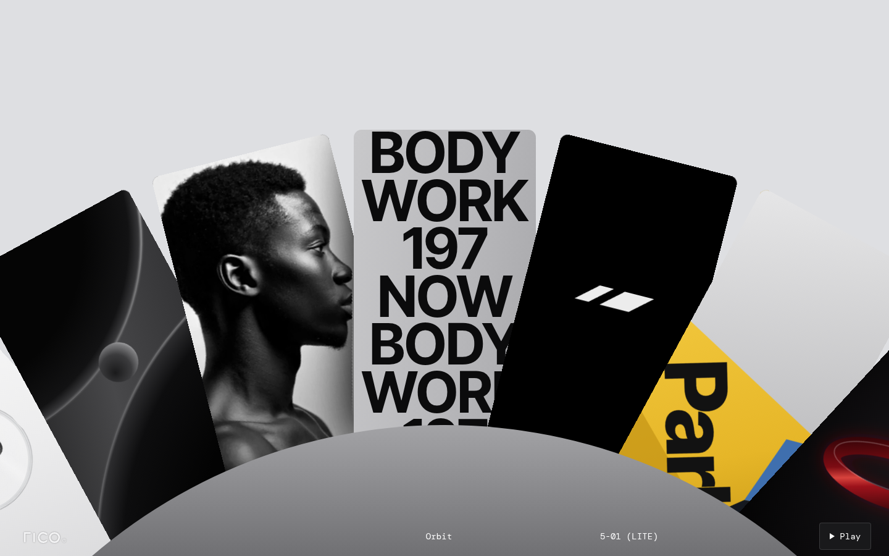

# Orbit

A feature showcase rebuilt from Jitter's free "Orbit" template (*rico.*, 5-01 LITE). Seven cards stand in a fan on the rim of a grey hub, and the whole wheel turns about a point far below the screen. Only one highlight faces the front at a time; the rest lean away on either side, so the page shows several features without packing them in.

Plain HTML, CSS and vanilla JS, with no dependencies. Classes are prefixed `ui-orbit`.

## What it does

The page plays the source video's 5.33s loop as a demo, then hands control to the visitor:

1. **Hold (0–0.2s).** *Bodywork* faces the front: heavy type, BODY / WORK / 197 / NOW, scrolling up the card.
2. **Swing out (0.2s).** The wheel turns one card clockwise, so the portrait on the left comes to the front. `cubic-bezier(.9, 0, .3, 1)` over 1.4s: a slow lift-off and a fast glide in.
3. **Hold (1.6–3.7s).** The coin card comes into view on the left.
4. **Swing back (3.7s).** Back to *Bodywork*, `cubic-bezier(.65, 0, .15, 1)` over 1.3s, with a long, soft landing. Then the loop repeats.

The cards also move on their own:

- **Bodywork:** the words scroll up at 93px a second (in source pixels), two full cycles per loop.
- **Ledger:** a glass coin with a reeded rim turns half a turn every 0.44s. Each half-turn eases in and out, so the word reads cleanly face-on, and the near rim wipes in the next ticker: USD → XRP → BTC → ETH.
- **Signal:** a white mark on black glitches four times a loop. It splits into five bands that slip sideways and drop out for about a quarter of a second.

### Visitor controls

| Input | Action |
| --- | --- |
| Click or tap a side card | Turn it to the front (the short way round) |
| ← / → | Previous / next highlight |
| Home / End | First / last highlight |
| Drag or swipe sideways | The wheel follows; let go and it settles on the nearest card, with a flick carrying it further |
| Sideways trackpad swipe | One step per gesture (vertical scrolling is left alone) |
| Pause / Play | Stop or restart all motion |

Once the visitor clicks, drags or uses the keys, the demo swing stops so it never fights them. The type, coin and glitch keep going until **Pause** is pressed. **Play** starts the swing again from the current card.

## Files

| File | What it is |
| --- | --- |
| `index.html` | The wheel: seven highlights, the hub, the footer bar and the controls |
| `style.css` | Geometry, card art, the coin, the hub and the footer |
| `script.js` | The clock, the swing, the per-card motion, input and accessibility state |
| `images/portrait.webp` | The portrait (470 × 762) |
| `preview.png` | The first frame, at 1440 × 900 |

The portrait is a temporal average of 40 frames of the source video (to remove compression noise), upscaled 2× with Lanczos and lightly sharpened. In the source, the next card covers a thin strip along the portrait's right edge. That strip was filled from a fitted model of the backdrop, corrected row by row to blend into the real pixels. It stays under the neighbouring card here too.

Everything else is drawn in SVG and CSS: the sphere-and-planets render, the *Park* sign, the red *Ember* ring, the coin and the *rico.* wordmark. The source's third-party sportswear logo is replaced with an original two-bar mark, and the *jitter.video* badge is replaced with the Pause button.

## How it is built

- **Geometry taken from the video.** Every card turns about one pivot 1250px down the 960 × 720 frame, 891px below the centre card's middle. Neighbours sit 14.25° apart, a figure fitted from the cards' edges. A card is 236px wide and its visible part is 382px tall. The hub is a disc of radius 699px on the same pivot, so each card's foot touches its rim. Cards run 50px further down behind the hub, so its curve never leaves a gap under their corners.
- **Sized from one unit.** `--u` is one source pixel: the height decides on wide screens (`100svh / 720`), and on narrow ones the centre card takes 60% of the width (`100vw / 393`). The centre card's middle sits at the source's 359px, or 47% of the height on tall screens. All sizes, the type and the coin scale from `--u`.
- **Stacking as in the source.** Each card lies on top of its left-hand neighbour. The hub lies over all of them, and the footer sits on the hub.
- **Fourteen places for seven cards.** Each highlight is in the DOM twice, so the ring is full. The card leaving one end comes back at the other about 100° round, well below the screen. The seven cards in view are always seven different ones, and on ultrawide screens anything beyond the third card out fades away so no highlight shows twice. The copy is `aria-hidden`.
- **One clock.** The swing, the type scroll, the coin and the glitch all read one clock, so Pause stops everything exactly. Add `?t=1.6` to the URL to freeze the demo at any moment, for design review and screenshots. `?autoplay=0` starts paused.
- **Coin in CSS 3D.** Two glass faces and 48 rim facets with a striped gradient form a reeded edge, which reads as fine lines when the coin is edge-on.

## Accessibility

- The wheel is a labelled carousel (`aria-roledescription="carousel"`) with one slide group per highlight ("1 of 7" and so on). Each card is a real `<button>` with a descriptive name, such as "Ledger: a glass coin turning over USD, XRP, BTC and ETH". The front card has `aria-current="true"`.
- **Roving tabindex.** Only the front card is in the tab order. The arrow keys, Home and End turn the wheel and keep focus on the new front card. The duplicate set is `aria-hidden` and never focusable.
- Moves the visitor makes are announced through a polite live region ("Profile, 4 of 7"). The demo itself stays quiet.
- The demo runs longer than 5 seconds, so there is a **Pause/Play** button (WCAG 2.2.2). It is a 44px target with a visible focus ring, and it stops every moving part. The swing also waits while keyboard focus is on a card. **Previous** and **Next** buttons appear when they receive keyboard focus.
- **Reduced motion:** nothing moves on its own. Steps happen instantly, the type, coin and glitch are still, and Play lets the visitor opt in.
- The footer text is white on the darkest part of the hub (at least 4.5:1). In forced-colours mode, cards and buttons get system borders.
- Checked with axe-core (WCAG 2.2 AA and best practice): no violations. No horizontal scroll at 390px wide.

## Customise

- **Highlights:** each `
` in `index.html`. Set `data-title` for announcements and `aria-label` on the button. Photo cards use `.ui-orbit__card--photo` with an `` inside. Seven cards suit the default framing (three either side of the front one).
- **Starting card:** `START` in `script.js`.
- **Tickers:** `TICKERS` in `script.js`.
- **Colours:** the `--ui-orbit-*` tokens at the top of `style.css`.
- **Pace:** `SWING_OUT`, `SWING_BACK`, `STEP_DUR`, `SCROLL_SPEED`, `HALF_TURN` and the glitch timings at the top of `script.js`.
- **Spacing:** `PITCH` in `script.js` (degrees between cards).
