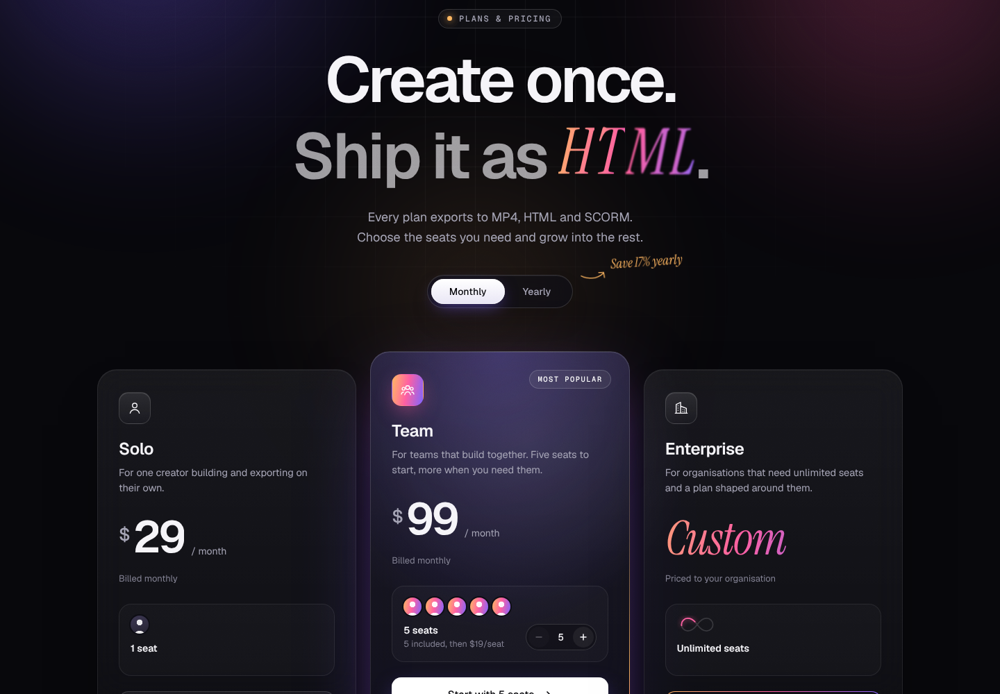

# Pricing page

A dark, cinematic pricing page with three plans (Solo, Team and Enterprise), a Monthly/Yearly toggle and a FAQ where only one answer is open at a time.



- Plain HTML, CSS and vanilla JS. Fonts are Geist, Geist Mono and Instrument Serif from Google Fonts.
- Classes are prefixed with `ui-`. Open `index.html` for the demo.
- Reduced motion turns off the drifting background, the rotating headline and the rolling digits. Without JS the page is fully visible, showing monthly prices.

## What's on it

| Part | Behaviour |
| --- | --- |
| Headline | "Ship it as ___" cycles MP4, HTML and SCORM. Each letter rises in with a blur, and the word slot resizes on a spring |
| Billing toggle | Real radio buttons with a sliding white thumb that squashes as it moves. A hand-drawn "Save 17% yearly" note points at Yearly. The percentage is worked out from the prices |
| Prices | Digits roll like an odometer, rightmost first. Yearly shows "Billed yearly as $X" and a "Save $X/yr" chip |
| Solo | 1 seat |
| Team | Featured card with a rotating gradient border. 5 seats included, and a stepper adds more (hold to repeat, getting faster). Each added seat pops in as an amber avatar and the price and button text update |
| Enterprise | "Custom" instead of a price, unlimited seats, and an "Inquire for pricing" button. The optional **AI agent integration** add-on has a switch that adds it to the inquiry email |
| Cards | A spotlight follows the pointer, and borders light up near it, including on neighbouring cards |
| FAQ | Opening a question closes the open one. Height, chevron and text all animate. Closed answers are `inert`, and Up, Down, Home and End move between questions |

## Editing prices

Prices live on each card in `index.html`. The script reads them, so nothing else needs to change:

```html
<article class="ui-plan" data-plan="solo" data-monthly="29" data-yearly="24">
<article class="ui-plan ui-plan--featured" data-plan="team"
         data-monthly="99" data-yearly="82"
         data-seats-included="5" data-seat-monthly="19" data-seat-yearly="16">
```

`data-yearly` is the **per-month** price on yearly billing. The save percentage, yearly totals, seat prices in the Team card and the FAQ, and the "Save $X/yr" chips are all calculated from these values.

The Team stepper's limit is `MAX_SEATS` (500) in `script.js`. The Enterprise inquiry address is the `mailto:` on the button marked `data-inquire`.

## Placeholder content to confirm

- All prices ($29 / $24 Solo, $99 / $82 Team, $19 / $16 per extra seat)
- `sales@example.com` for the inquiry and "Talk to us" links
- The tagline copy, the AI add-on description and the FAQ answers (plan changes and payment methods especially)
- Currency and the "Prices shown exclude tax" note

## Tokens

Set on `:root` in `style.css`.

| Token | Default | Purpose |
| --- | --- | --- |
| `--ui-ink` | `#07070b` | Page background |
| `--ui-iris` / `--ui-rose` / `--ui-amber` | `#7b61ff` / `#ff5c9e` / `#ffb45e` | Accent colours, also used in `--ui-grad` |
| `--ui-radius` | `28px` | Card corner radius |
| `--ui-spring` | `cubic-bezier(.34,1.56,.64,1)` | Overshoot easing for the toggle, stepper and chevrons |
| `--ui-out` | `cubic-bezier(.16,1,.3,1)` | Ease-out for reveals and rolls |
