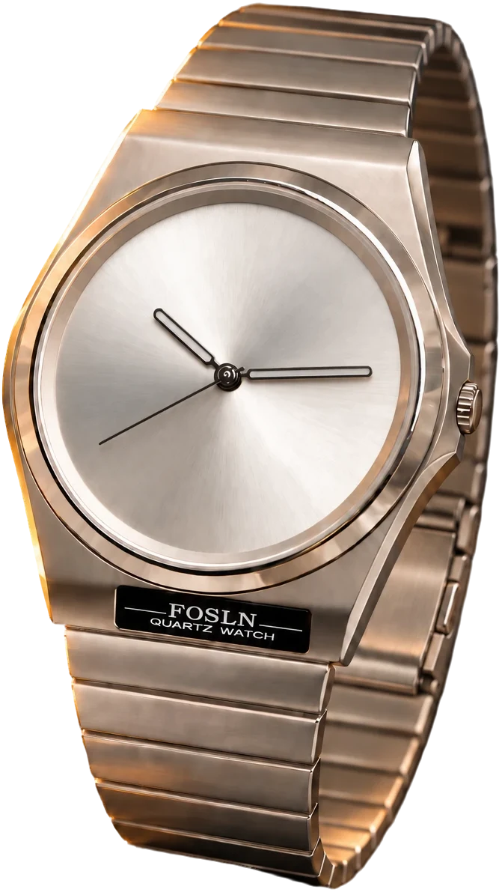
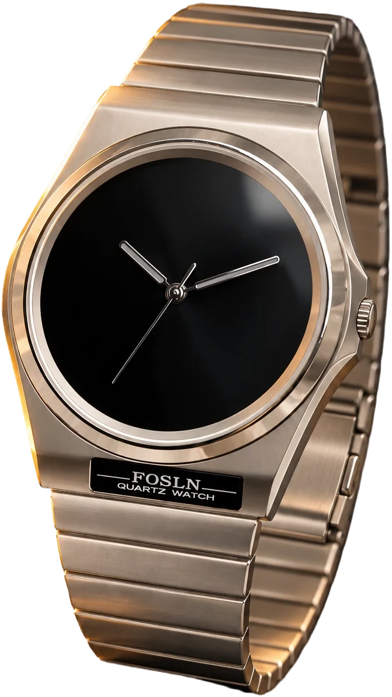

# Product Card (watch)

The watch edition of the [product card](../product-card/), for the FOSLN ACIER quartz watch. It has the same layout, build-in, colourway switching and fly-to-cart as the original, set up for a tall product. The look is golden hour on dark volcanic stone. A near-black stage, lit by a warm glow from the upper left, holds a champagne "ACIER". The watch stands in front of it and crosses into a dark stone footer, which carries the price, two dial swatches and a gold "Add to cart" button.

- **Layout:**
  - Top row: back button, plus a cart button with a count badge.
  - Spec line: "Quartz watch" on the left, the brand "FOSLN" on the right.
  - Wordmark: "ACIER", edge to edge, sitting behind the watch. It's sized for five letters.
  - Watch: stands over the lower half of the wordmark, from the stage into the footer, over a soft contact shadow.
  - Footer: "$249" on the left, the Chrome and Onyx swatches on the right, CTA underneath.
- **Theme:** taken from a moody product shot of the watch on dark rock in low golden light:
  - a fine stone grain over the stage and footer
  - a warm glow from the upper left
  - a thin gold line where the stage meets the footer
  - the steel warmed slightly, as it would be in that light
- **Colours:** two colourways, named after the dial:
  - **Chrome, golden hour:** stone black with an amber glow, a champagne wordmark, gold spec line and a gold button. The chrome dial is warmed slightly.
  - **Onyx, after dark:** deeper and cooler, the glow down to an ember, an ivory wordmark and a silver button. It has the black dial and no warming.

  Picking one crossfades the watch photo and blends every colour across.
- **Button:** one centred "Add to cart" label with a small cart icon, and no side note. After an add it reads "✓ Added". If the add fails, the error message takes the label's place for a few seconds. When the dial is sold out it reads "Sold out" and dims. A short note on the right (such as "Free returns") is still possible: add a `.ui-wcard__cta-note` span, and the label moves left to make room.
- **Add to cart:** the watch lifts off the stage, shrinks and arcs into the cart icon in about 0.76s. Because it's tall, it shrinks by its height, so it stays inside the card. When it lands:
  - the cart icon gives a little wobble
  - the badge counts up with a bump
  - the label flips to "✓ Added"
  - a screen-reader status announces it
  - the card fires a `ui-wcard:add` event

  0.23s after landing, the watch regrows in place from a soft blur. Clicks during the flight are ignored. With reduced motion turned on, the item is counted straight away and nothing flies.
- **Motion:**
  - On first view, everything builds left to right with one move: each piece shoots out from behind the one before it, staying hidden until it clears it, then overshoots a touch, squashes and locks in. Each lock sets off the next piece, one every 95ms (tune it with `--ui-wcard-beat`).
  - The order is: A, C, I, E, R, with the spec line alongside; then price, Chrome, Onyx and Add to cart; and finally the watch drops in. The script counts the letters and swatches, so a different word or more colourways keep the order.
  - The word gives a small recoil on each letter's hit.
  - The watch then floats gently, with its shadow breathing.
  - With a mouse, the watch drifts slightly as the pointer moves while the wordmark stays still.
- **Reduced motion:** colour changes still happen, but nothing moves.
- **Scaling:** every size is derived from the card's width (390 design units through container query units), so the whole composition scales as one piece from a 320px phone up to the 430px max width.

Plain HTML, CSS and vanilla JS, no dependencies. Classes are prefixed `ui-wcard`, so it can sit on the same page as the original card (`ui-pcard`). Open `index.html` for the demo, shown inside a phone frame.

## Files

| File | What it is |
| --- | --- |
| `index.html` | Demo page: the card inside a phone frame with a status bar |
| `style.css` | Component styles and the Chrome and Onyx themes |
| `script.js` | Swatches, add to cart, entrance and pointer parallax |
| `images/acier-*.webp` | Transparent watch cut-outs, chrome and black dial (687 × 1253) |
| `shopify/ui-wcard.liquid` | Shopify section: the card for a real product, with one block per colourway |
| `shopify/ui-wcard-shopify.js` | Shopify connection: variants, real add to cart, header cart count |

## Markup

```html
<article class="ui-wcard" data-ui-wcard data-colorway="chrome">
  <div class="ui-wcard__inner">
    <div class="ui-wcard__stage" aria-hidden="true"></div>

    <header class="ui-wcard__bar">
      <button class="ui-wcard__icon" type="button" aria-label="Back">…</button>
      <button class="ui-wcard__icon" type="button" aria-label="Cart, 1 item" data-ui-wcard-bag>
        …<span class="ui-wcard__badge" aria-hidden="true">1</span>
      </button>
    </header>

    <p class="ui-wcard__specs"><span>Quartz watch</span><span>FOSLN</span></p>

    <h2 class="ui-wcard__title">
      <span aria-hidden="true">ACIER</span>
      <span class="ui-wcard__sr">FOSLN Acier quartz watch</span>
    </h2>

    <figure class="ui-wcard__media">
      <span class="ui-wcard__shadow" aria-hidden="true"></span>
      <span class="ui-wcard__float">
        
        
      </span>
    </figure>

    <div class="ui-wcard__body">
      <div class="ui-wcard__row">
        <p class="ui-wcard__price-label">Price <strong class="ui-wcard__price">$249</strong></p>
        <fieldset class="ui-wcard__swatches">
          <legend class="ui-wcard__sr">Colour</legend>
          <label class="ui-wcard__swatch" style="--swatch: #8DB28F">
            <input type="radio" name="acier-colour" value="chrome" checked>
            <span class="ui-wcard__dot" aria-hidden="true"></span>
            <span class="ui-wcard__swatch-name">Chrome</span>
          </label>
          …
        </fieldset>
      </div>
      <button class="ui-wcard__cta" type="button">
        <span class="ui-wcard__cta-labels">
          <span class="ui-wcard__cta-add"><svg viewBox="0 0 24 24">…</svg>Add to cart</span>
          <span class="ui-wcard__cta-done" aria-hidden="true"><svg>…</svg>Added</span>
        </span>
      </button>
      <p class="ui-wcard__sr" role="status" aria-live="polite" data-ui-wcard-status></p>
    </div>
  </div>
</article>
```

The swatches are real radio inputs, so arrow keys, focus and screen readers work without extra code. Each radio's `value` must match an image's `data-colorway`.

## Theming

Colours live in custom properties on `.ui-wcard`. Each colourway overrides the stage, wordmark, spec line and button colours:

```css
.ui-wcard[data-colorway="onyx"] {
  --ui-wcard-stage-1: #24221F;   /* warm lift behind the watch */
  --ui-wcard-stage-2: #0C0B0A;   /* stage */
  --ui-wcard-stage-top: #030303; /* ombré: the top third darkens to this */
  --ui-wcard-glow: #6E5534;      /* the light from the upper left */
  --ui-wcard-title: #E4E1DA;     /* wordmark, icons, badge */
  --ui-wcard-specs: #8F8A80;     /* spec line */
  --ui-wcard-cta-bg: #E9E4DA;    /* button gradient, light end */
  --ui-wcard-cta-bg-2: #A9A399;  /* button gradient, dark end */
  --ui-wcard-ring: #D9D3C7;      /* selected swatch ring */
  --ui-wcard-seam: rgba(220, 212, 198, 0.3); /* line between stage and footer */
  --ui-wcard-tone: none;         /* filter on the watch photo; Chrome warms it */
}
```

These properties are registered with `@property`, so switching colourways blends the gradient smoothly rather than snapping. Other settings:

| Property | Default | What it does |
| --- | --- | --- |
| `--ui-wcard-font` | Manrope | Typeface for everything |
| `--ui-wcard-body-bg` | `#16130F` | Dark stone footer (a fine grain sits on top) |
| `--ui-wcard-ink` | `#F1E8D6` | Price and swatch labels |
| `--ui-wcard-cta-fg` | `#1A140B` | Button text, dark on the gold |
| `--ui-wcard-radius` | `28` | Corner radius in design units |
| `--ui-wcard-inset-top` | `0px` | Extra top padding when the card sits under a status bar |

The demo loads Manrope from Google Fonts.

## Events

```js
document.addEventListener("ui-wcard:add", function (e) {
  // e.detail = { colorway: "chrome", count: 2 }
});
```

## Connecting a cart

Set `window.uiWcardAdd` to add the item for real. It's called on click, while the product flies, and should return a Promise:

```js
window.uiWcardAdd = function ({ card, colorway }) {
  return fetch("/my-cart/add", { method: "POST" /* … */ })
    .then(function (res) { return res.json(); })
    .then(function (cart) { return { count: cart.count }; });  // the badge shows this
};
```

- **The badge waits for it.** If the request is still running when the product reaches the cart icon, the count goes up when it resolves.
- **On failure,** reject with an `Error`. Its message takes the place of the button label for a few seconds, the button gives a short shake, the product comes back and nothing is counted.
- **Without the hook,** the count simply goes up by one.

A disabled button (`disabled` attribute) ignores clicks, and the card dims it.

## Shopify

The `shopify/` folder turns the card into a theme section for a real product.

1. **Assets.** Upload three files to the theme's `assets/` folder:
   - this folder's `style.css` as `ui-wcard.css`
   - this folder's `script.js` as `ui-wcard.js`
   - `shopify/ui-wcard-shopify.js` as is
2. **Section.** Add `shopify/ui-wcard.liquid` to `sections/`.
3. **Product page.** In the theme editor, open a product template and add the **UI product card (watch)** section. It uses that page's product. You can hide the theme's own product section, or keep it below for the full description. On any other page, pick a product in the section settings.
4. **Colourways.** The section reads the product's colour option ("Color", "Colour" or "Dial" by default; change it in the settings). It adds one swatch per value. Each **Colourway** block matches one value by name and sets:
   - its swatch colour
   - a **cut-out image**: a transparent PNG or WebP, portrait, with the product filling the frame
   - its card colours: stage, ombré, light glow, wordmark, spec line, the button's two gradient colours, and ring

   The preset comes with Chrome and Onyx. Values without a block use the theme's swatch colour, the variant image and the Chrome card colours. Products without a colour option show one image and no swatches.
5. **Text.** The settings cover the wordmark, spec line, price label, button label, "Added", "Sold out" and an optional button note (empty by default, which keeps the label centred). The wordmark defaults to the first word of the product title. Short words of 3–5 letters fill the card best.

**What the connection does:**
- Picking a swatch selects that colour's variant, updates the price, and shows "Sold out" (and disables the button) when it's unavailable.
- Add to cart posts to Shopify's Cart AJAX API (`/cart/add.js`) while the product flies. The badge then shows the real cart count.
- Shopify's errors, such as "All 1 Acier - Onyx are in your cart.", show on the button.
- It refreshes a Dawn-style `#cart-icon-bubble` in the theme header and fires `ui-wcard:cart` on `document` with `{ cart }`, for themes that refresh their cart drawer some other way.
- Without JavaScript, the button is a normal product form submit.

**Limits:**
- The swatches handle one option. On products with more options, such as size, each colour adds its first available variant.
- The cart icon links to `/cart`.
- The back button goes back if the visitor came from the store, otherwise to the product's first collection.

## Product images

The cut-outs are transparent WebP files with the watch filling the frame (687 × 1253). The Onyx image is the chrome photo with the dial recoloured: a black sunray that keeps the brushed streaks, polished steel hands, and white lume. Swap in a real photo of the black-dial watch when you have one.

To use another product, export a transparent PNG/WebP per colourway. If the aspect is different, update `aspect-ratio`, `width` and `top` on `.ui-wcard__media`. If the wordmark has a different number of letters, adjust `font-size` on `.ui-wcard__title`; it's 132 units for five letters, and the original card uses 140 for four.
