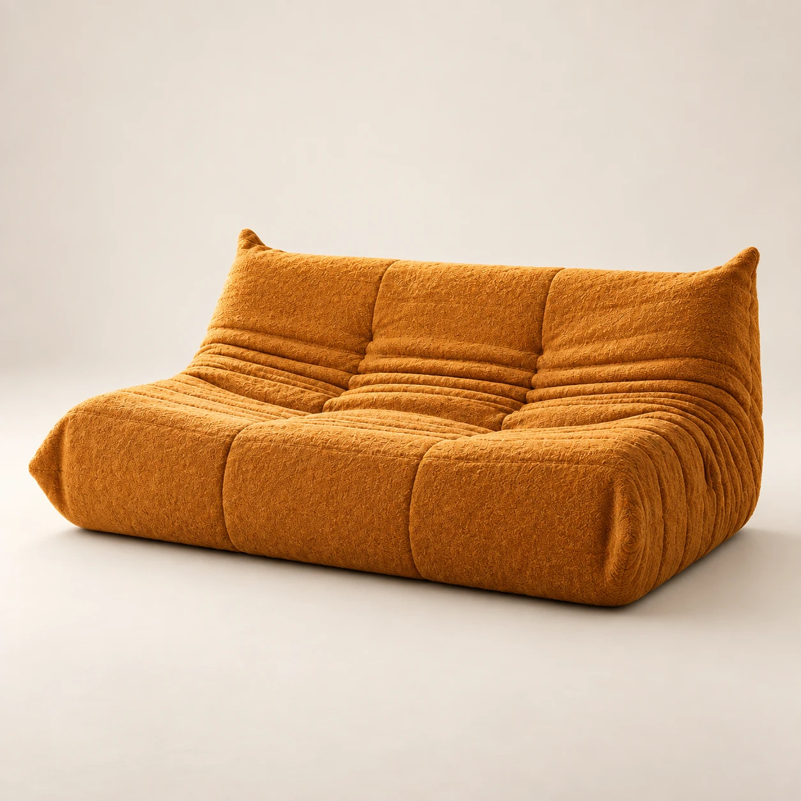
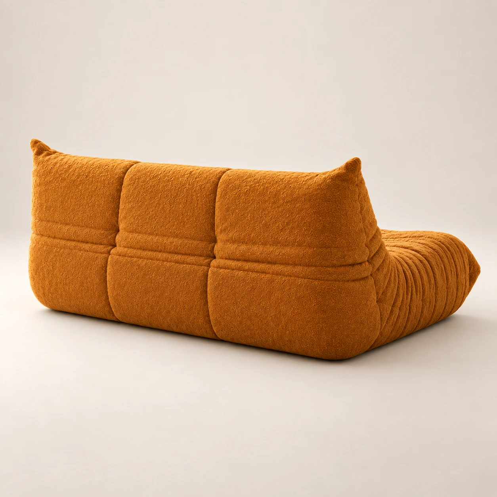

# Product Turntable

One interactive product display in place of a row of photos. Drag or swipe, and the product turns: the view doesn't slide to the next photo, the object itself rotates. It's built from a handful of ordinary product photos, 5 in the demo.

## How it creates the in-between angles

It's a WebGL shader with no libraries. Between any two photographed angles it does three things:

1. **Silhouette morph.** When the page loads, the script finds the product's outline in every photo (colour against the neutral backdrop) and builds a smooth field from it. During a turn, the two fields are blended and cut at the midpoint. The outline morphs continuously from one view to the next with a crisp edge. It's never a see-through double image.
2. **Surface rotation.** Both photos are also re-mapped so their outlines line up. The surface slides across a cylinder in the direction of the turn, and the texture swaps from one photo to the other once they overlap.
3. **Motion cues.** Motion blur tied to speed hides the join while it moves, and a soft contact shadow follows the morphing base.

Momentum and a spring bring the product to rest **exactly on a real photo**, so the still image is always crisp and true.

## Controls

- **Drag or swipe:** turns 1:1, with momentum. On phones only horizontal swipes turn it; vertical swipes still scroll the page.
- **Trackpad:** a horizontal swipe turns it.
- **Keyboard:** ← and → step between angles when the display has focus, and Home returns to the front.
- **Dial:** click a tick to rotate there the short way round. The centre icon and caption show the current view.
- **Idle sway:** on load a small sway and a "Drag to turn" hint show that it's interactive.

With reduced motion turned on, there's no idle sway, no momentum and no blur. Without WebGL it falls back to a plain crossfade.

## Colourways

Give each colourway its own `.ui-turn__frames` group, then add swatches anywhere on the page:

```html
<div class="ui-turn__frames" data-colorway="saffron" data-label="Saffron bouclé" data-tint="#C07A2E"> …photos… </div>
<div class="ui-turn__frames" data-colorway="onyx" data-label="Onyx bouclé" data-tint="#2B2927"> …photos… </div>

<span data-ui-turn-colorway-label>Saffron bouclé</span>
<button data-ui-turn-colorway="saffron" aria-pressed="true">…</button>
<button data-ui-turn-colorway="onyx" aria-pressed="false">…</button>
```

- **The angle is kept.** Changing colour keeps the current angle. The new colour spreads through the product in place: a soft radial "re-dye" that starts from the side nearest the tapped swatch. Dragging still works while it happens.
- **Details follow.** The label crossfades, `aria-pressed` updates on the swatches, and `data-tint` recolours the dial accent.
- **Loading.** The first colourway loads with the page, and the others prefetch when the browser is idle. If a swatch is tapped before its photos are ready, a thin ring spins around it until they are.
- **API.** Call `root.uiTurn.setColorway("onyx")`. The `ui-turn:colorway` event fires when a change finishes.
- **Photos.** Every colourway should be photographed at the same angles.

## Markup

```html
<div class="ui-turn" data-ui-turn data-name="Dune low sofa">
  <div class="ui-turn__stage" tabindex="0" role="img" aria-label="Dune low sofa. Drag or use arrow keys to turn.">
    
    <canvas class="ui-turn__canvas" aria-hidden="true"></canvas>
    <div class="ui-turn__frames">
      
      
      
      <!-- data-mirror reuses a photo flipped, for symmetric products -->
      
      ...
    </div>
    <div class="ui-turn__hint" aria-hidden="true">Drag to turn</div>
  </div>
  <!-- optional dial: see index.html -->
</div>
```

- `data-angle` is the viewing angle of each photo in degrees. Angles don't need to be evenly spaced.
- `data-mirror` flips a photo. The demo reuses 3 photos this way to complete the full circle.
- `data-drag-degrees` on the root controls how far a full-width drag turns the product (default 180).
- `data-zoom` controls how much of the stage the product fills (default 0.86).

## Photographing products for it

The turntable invents the angles between photos, so **more photos means less invention and a more seamless turn**:
- **5 photos** (every 45°, as in the demo) work, but mid-turn frames are visibly morphed.
- **12 photos** (every 30°) is the minimum worthwhile.
- **24 photos** (every 15°) is recommended. At 20° apart or less, the turntable automatically switches from the silhouette morph to a light aligned blend, which reads as real rotation.
- **36 photos** (every 10°) is the smoothest option.

Setup:
- Rotate the **product** on a turntable or marked positions. Keep the camera locked on a tripod.
- Shoot the full 360° instead of mirroring.
- Use square 2000×2000 px, with the product centred on the rotation axis and filling about 80% of the width.
- Name files by angle: `000`, `015` … `345`.
- If the images are 3D renders, export a 24- or 36-frame turntable animation from the same scene.

General tips:

- Use the same backdrop, lighting, camera height and distance for every shot. The product should sit in the same place in the frame.
- Take 5 to 8 angles around the product. Symmetric pieces can reuse mirrored shots.
- Use a neutral backdrop. The outline detection treats saturated colour and dark tones as product and the pale backdrop as background. Very pale, grey or white products may need a slightly darker backdrop, or adjusted `SAT_THRESHOLD` / `DARK_THRESHOLD` values in `script.js`.
