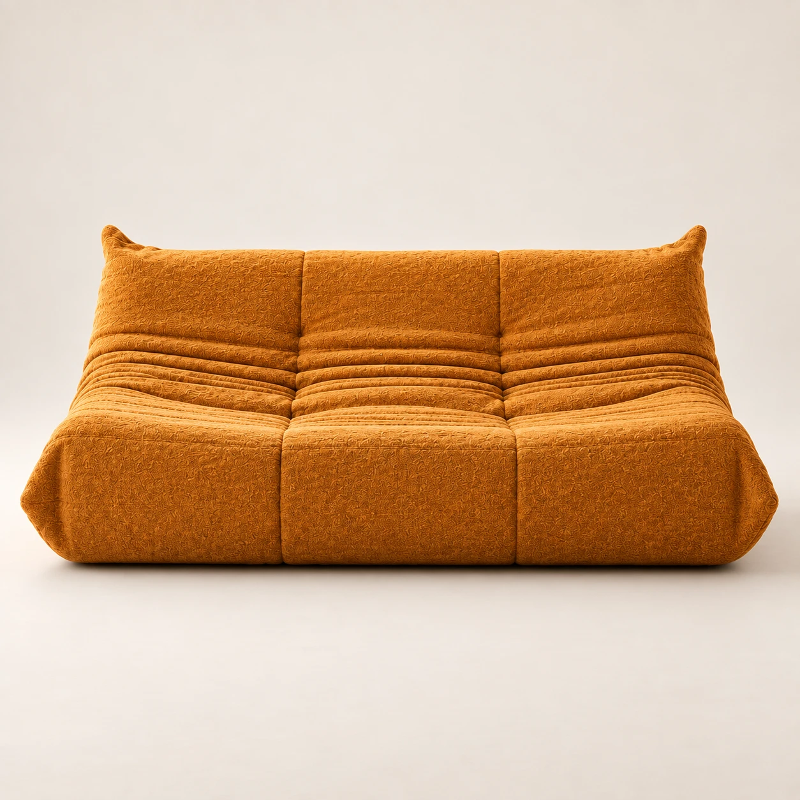
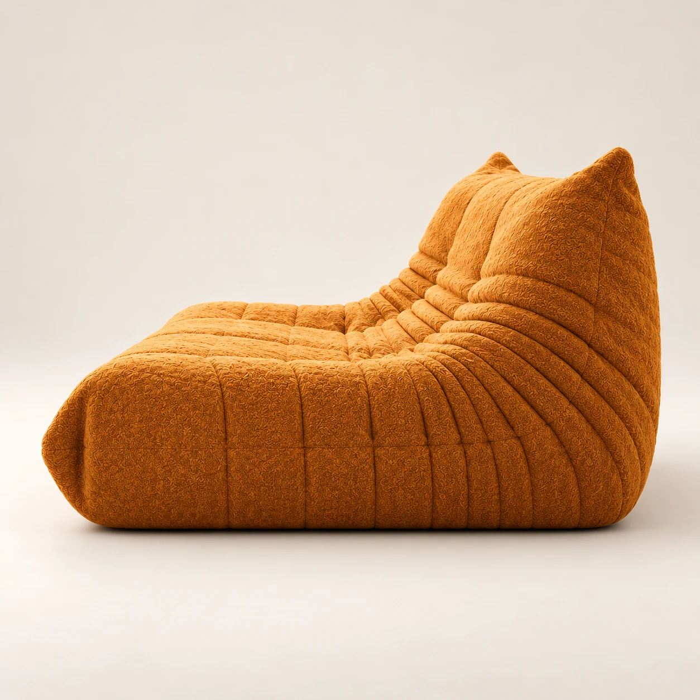

# Product Turntable

One interactive product display in place of a row of photos. Drag or swipe, and the product turns: the view doesn't slide to the next photo, the object itself rotates. It's built from a handful of ordinary product photos, 5 in the demo.

## How it creates the in-between angles

It's a WebGL shader with no libraries. Between any two photographed angles it does three things:

1. **Silhouette morph.** When the page loads, the script finds the product's outline in every photo (colour against the neutral backdrop) and builds a smooth field from it. During a turn, the two fields are blended and cut at the midpoint. The outline morphs continuously from one view to the next with a crisp edge. It's never a see-through double image.
2. **Surface rotation.** Both photos are also re-mapped so their outlines line up. The surface slides across a cylinder in the direction of the turn, and the texture swaps from one photo to the other once they overlap.
3. **Motion cues.** Motion blur tied to speed hides the join while it moves, and a soft contact shadow follows the morphing base.

Momentum and a spring bring the product to rest **exactly on a real photo**, so the still image is always crisp and true.

## Controls

- **Drag or swipe:** turns 1:1, with momentum. On phones only horizontal swipes turn it; vertical swipes still scroll the page.
- **Trackpad:** a horizontal swipe turns it.
- **Keyboard:** ← and → step between angles when the display has focus, and Home returns to the front.
- **Dial:** click a tick to rotate there the short way round. The centre icon and caption show the current view.
- **Idle sway:** on load a small sway and a "Drag to turn" hint show that it's interactive.

With reduced motion turned on, there's no idle sway, no momentum and no blur. Without WebGL it falls back to a plain crossfade.

## Markup

```html
<div class="ui-turn" data-ui-turn data-name="Dune low sofa">
  <div class="ui-turn__stage" tabindex="0" role="img" aria-label="Dune low sofa. Drag or use arrow keys to turn.">
    
    <canvas class="ui-turn__canvas" aria-hidden="true"></canvas>
    <div class="ui-turn__frames">
      
      
      
      <!-- data-mirror reuses a photo flipped, for symmetric products -->
      
      ...
    </div>
    <div class="ui-turn__hint" aria-hidden="true">Drag to turn</div>
  </div>
  <!-- optional dial: see index.html -->
</div>
```

- `data-angle` is the viewing angle of each photo in degrees. Angles don't need to be evenly spaced.
- `data-mirror` flips a photo. The demo reuses 3 photos this way to complete the full circle.
- `data-drag-degrees` on the root controls how far a full-width drag turns the product (default 180).
- `data-zoom` controls how much of the stage the product fills (default 0.86).

## Photographing products for it

- Use the same backdrop, lighting, camera height and distance for every shot. The product should sit in the same place in the frame.
- Take 5 to 8 angles around the product. Symmetric pieces can reuse mirrored shots.
- Use a neutral backdrop. The outline detection looks for the product's colour against it. Very pale or grey products may need a slightly darker backdrop.
