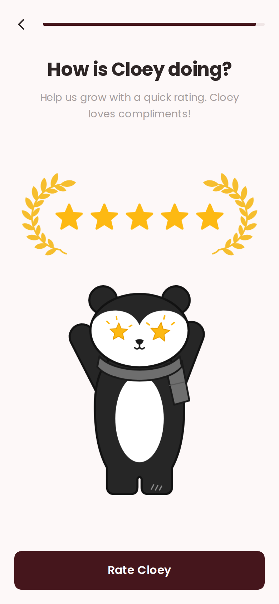

# App Rating Screen

A full-screen "How is Cloey doing?" step for a mobile app's onboarding, asking the user to rate the app. It's a whole screen, not a popup. This first pass copies the Cloey reference: same copy, colours and font.



- **Layout** (top to bottom):
  - Top bar: a back arrow and a thin maroon progress bar, almost full.
  - Title "How is Cloey doing?" in bold Poppins, and the line "Help us grow with a quick rating. Cloey loves compliments!" in grey below it.
  - Five gold stars between two gold laurel branches.
  - Cloey the panda, arms up, with star eyes and a grey scarf.
  - A full-width maroon "Rate Cloey" button pinned to the bottom.
- **Flow:**
  1. Tapping **Rate Cloey** fires `ui-rate:request`. That's where the app opens the native review prompt (`SKStoreReviewController` / `requestReview` on iOS, the In-App Review API on Android).
  2. The button then reads **I rated**, and a grey underlined **Not now** link appears under it.
  3. **I rated** fires `ui-rate:done`, **Not now** fires `ui-rate:skip`. Move to the next step on either.
- **Motion:** the laurels grow in and the stars pop in one after another. The panda bobs gently, waves both arms and its star eyes twinkle. Reduced motion turns all of it off.
- **Fit:** the screen fills its container, respects the safe-area insets, and the panda shrinks to fit shorter phones (it's tested down to an iPhone SE).
- Plain HTML, CSS and vanilla JS. The stars, laurels and panda are inline SVG, so there are no image files.

Open `index.html` for the demo. On a laptop it sits in a phone frame, and the line under the frame shows each event as it fires. On a phone it fills the screen.

## Use it

1. Load Poppins and include `style.css` in the `<head>`, and `script.js` before `</body>`.
2. Copy the `<main class="ui-rate" data-ui-rate>` block from `index.html` into a container that's the height of the screen.
3. Listen for the events:

```js
const screen = document.querySelector("[data-ui-rate]");
screen.addEventListener("ui-rate:request", () => { /* open the native review prompt */ });
screen.addEventListener("ui-rate:done", () => { /* next step */ });
screen.addEventListener("ui-rate:skip", () => { /* next step */ });
screen.addEventListener("ui-rate:back", () => { /* previous step */ });
```

On the web, set `data-store-url="https://apps.apple.com/app/id…"` on the screen and **Rate Cloey** also opens that page in a new tab. Call `event.preventDefault()` in your `ui-rate:request` listener to stop it.

| Attribute | Default | Purpose |
| --- | --- | --- |
| `data-done-label` | `I rated` | Button label after the first tap |
| `data-store-url` | none | Store page to open on the first tap |
| `style="--ui-rate-progress: 96%"` on `.ui-rate__progress` | `96%` | How full the progress bar is. Update `aria-valuenow` to match |

`window.uiRate.reset(screen)` puts the button back to **Rate Cloey** and hides **Not now**. `window.uiRate.init(screen)` sets up a screen added after the page loaded.

## Tokens

Set these on `.ui-rate`.

| Token | Default | Purpose |
| --- | --- | --- |
| `--ui-rate-bg` | `#FDF8F8` | Screen background |
| `--ui-rate-ink` | `#2E2626` | Title and back arrow |
| `--ui-rate-muted` | `#A79F9F` | Line under the title |
| `--ui-rate-brand` | `#45161C` | Button and progress fill |
| `--ui-rate-brand-ink` | `#FFFFFF` | Button text |
| `--ui-rate-track` | `#F0E6E6` | Progress track |
| `--ui-rate-gold` | `#FDB913` | Stars and the panda's eyes |
| `--ui-rate-laurel` | `#F6BE2E` | Laurel branches |
| `--ui-rate-skip` | `#BDB5B5` | "Not now" link |
| `--ui-rate-font` | `"Poppins", …` | Font |
| `--ui-rate-radius` | `10px` | Button corner radius |
