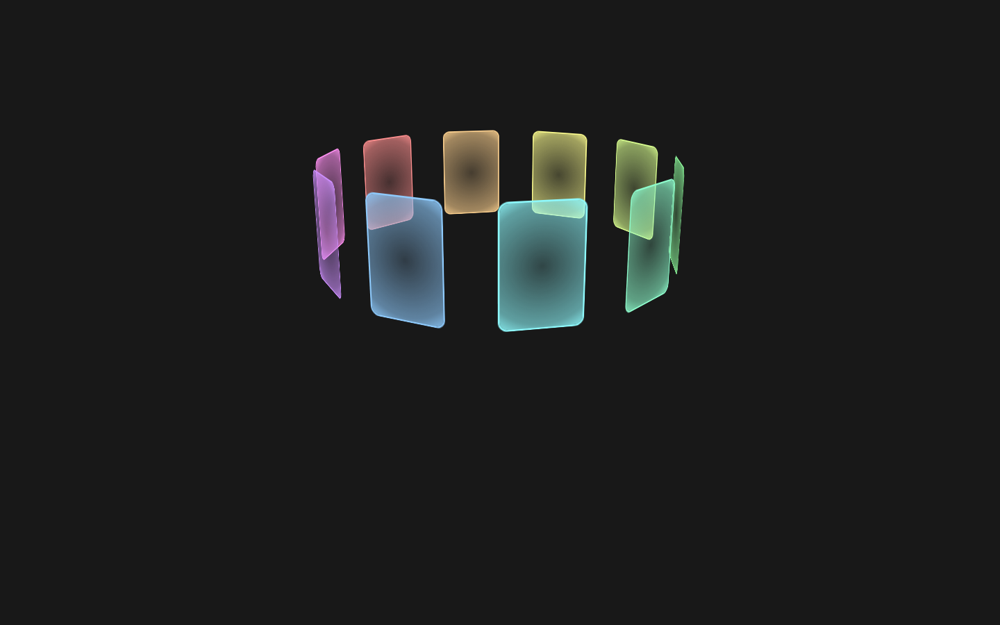

# Rotating Cards

A ring of ten glass cards, each tinted one step along a rainbow, turning slowly in 3D. The ring is tipped back 15° so you look down on it, and each card glows from a dark centre to a bright rim in its own colour.

Plain HTML and CSS, with no JavaScript and no dependencies. From [Uiverse.io](https://uiverse.io) by ilkhoeri.

## How it works

- **The ring.** `.inner` is a 100 × 150px box with `transform-style: preserve-3d`. Each `.card` turns by `360deg / --quantity × --index` around the Y axis, then moves out `--translateZ` (250px), so the ten cards stand evenly round a circle.
- **The turn.** `.inner` spins one full turn every 20s (`linear`, forever), with a 1000px perspective and a fixed `rotateX(-15deg)` tilt.
- **The glass.** Each `.img` fills its card with a `radial-gradient` of the card's colour, from 20% opacity in the middle to 90% at the edge, behind a 2px border in the same colour.

## Files

| File | What it is |
| --- | --- |
| `index.html` | The ring and its ten cards |
| `style.css` | Layout, the 3D ring, the animation and the glass gradient |
| `preview.png` | A still at 1440 × 900 |

## Use it

Copy the `.wrapper` block from `index.html` and the rules from `style.css`. The wrapper fills its parent, so give the parent a height (the demo makes `html` and `body` 100% tall on a `#181818` background).

## Customise

- **Colours:** set `--color-card` on each card as an `R, G, B` triple.
- **Card count:** add or remove `.card`s, number them from 0 with `--index`, and set `--quantity` on `.inner` to match.
- **Size and spread:** `--w` and `--h` set the card size; `--translateZ` (by default `--w + --h`) sets the ring's radius.
- **Tilt and depth:** `--rotateX` and `--perspective` on `.inner`.
- **Speed:** the `20s` in the `animation` on `.inner`.
- **Content:** put an `` inside `.img` (or swap the `
` for an ``); `object-fit: cover` is already set.

## Accessibility

- The ring is decoration, so the wrapper is `aria-hidden="true"`. Give it real content and a label if the cards carry meaning.
- With **reduced motion** turned on, the ring stands still.
