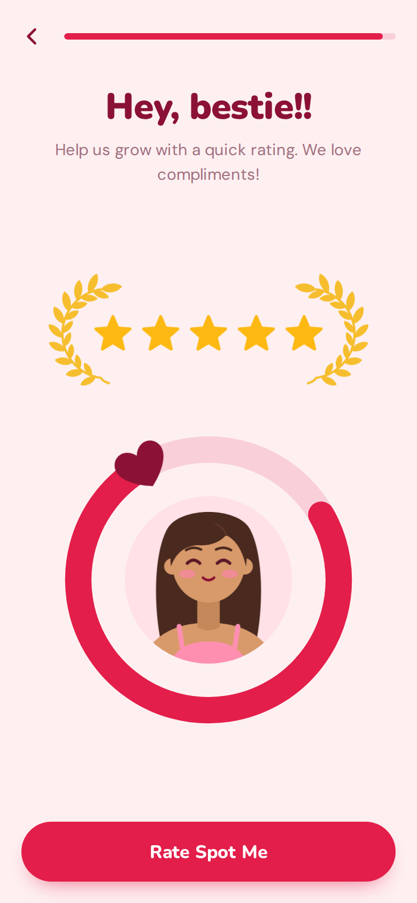

# Spot Me Rating Screen

The [app rating screen](../rate-screen/) rebranded for Spot Me, a secret diary for your gym crush. It's a full screen, not a popup, with the light "Blush Diary" look: Spot Me's maroon and crush-ring red on blush pink, and the avatar inside the crush ring.



- **Layout** (top to bottom):
  - Top bar: a back arrow and a red progress bar, almost full.
  - Title "Hey, bestie!!" in heavy Nunito, and "Help us grow with a quick rating. We love compliments!" in DM Sans.
  - Five gold stars between two gold laurel branches, kept from the original screen for now.
  - The avatar from the "Everyone has a gym crush" artwork in a pink circle, inside the crush ring. The ring is three-quarters full, with the heart at its top left.
  - A full-width red pill button, "Rate Spot Me".
- **Flow:**
  1. Tapping **Rate Spot Me** fires `ui-spot-rate:request`. That's where the app opens the native review prompt (`SKStoreReviewController` / `requestReview` on iOS, the In-App Review API on Android).
  2. The button then reads **I rated!**, and an underlined **Not now** link appears under it. At the same time the heart rides round the top of the ring, filling the rest of it in behind it. When the ring is full the heart gives a big pop and pink confetti bursts out of the ring and falls across the screen, to celebrate the rating.
  3. **I rated!** fires `ui-spot-rate:done`, **Not now** fires `ui-spot-rate:skip`, and the back arrow fires `ui-spot-rate:back`.
- **Motion:** the laurels grow in and the stars pop in one after another. Then the ring fills to three-quarters and the heart pops on at the end of it. After that the heart gives a little beat every few seconds, and the avatar bobs gently. Reduced motion turns all of it off: after the first tap the ring just shows full, with no confetti.
- **Fit:** the screen fills its container and respects the safe-area insets. The ring shrinks to fit shorter phones (it's tested down to an iPhone SE).
- Plain HTML, CSS and vanilla JS. The stars, laurels, ring and avatar are all inline SVG, so there are no image files.

Open `index.html` for the demo. On a laptop it sits in a phone frame, and the line under the frame shows each event as it fires. On a phone it fills the screen.

## Use it

1. Load Nunito (800, 900) and DM Sans (400, 500), and include `style.css` in the `<head>` and `script.js` before `</body>`.
2. Copy the `<main class="ui-spot-rate" data-ui-spot-rate>` block from `index.html` into a container that's the height of the screen.
3. Listen for the events:

```js
const screen = document.querySelector("[data-ui-spot-rate]");
screen.addEventListener("ui-spot-rate:request", () => { /* open the native review prompt */ });
screen.addEventListener("ui-spot-rate:done", () => { /* next step */ });
screen.addEventListener("ui-spot-rate:skip", () => { /* next step */ });
screen.addEventListener("ui-spot-rate:back", () => { /* previous step */ });
```

On the web, set `data-store-url="https://apps.apple.com/app/id…"` on the screen and **Rate Spot Me** also opens that page in a new tab. Call `event.preventDefault()` in your `ui-spot-rate:request` listener to stop it.

| Attribute | Default | Purpose |
| --- | --- | --- |
| `data-done-label` | `I rated!` | Button label after the first tap |
| `data-store-url` | none | Store page to open on the first tap |
| `style="--ui-spot-rate-progress: 96%"` on `.ui-spot-rate__progress` | `96%` | How full the progress bar is. Update `aria-valuenow` to match |

The screen gets `.is-asked` after the first tap and `.is-complete` once the ring is full, which is when the confetti fires. The confetti is plain `<i>` pieces animated with the Web Animations API in a `.ui-spot-rate__confetti` layer, removed as each one lands.

`window.uiSpotRate.reset(screen)` puts the button back to **Rate Spot Me**, hides **Not now**, and refills the ring to three-quarters. `window.uiSpotRate.init(screen)` sets up a screen added after the page loaded.

## Tokens

Set these on `.ui-spot-rate`.

| Token | Default | Purpose |
| --- | --- | --- |
| `--ui-spot-rate-bg` | `#FEF0F1` | Screen background (blush) |
| `--ui-spot-rate-ink` | `#8B1235` | Title, back arrow and heart (maroon) |
| `--ui-spot-rate-muted` | `#A27080` | Line under the title and "Not now" |
| `--ui-spot-rate-brand` | `#E31E4A` | Button, progress fill and ring (crush red) |
| `--ui-spot-rate-brand-ink` | `#FFFFFF` | Button text |
| `--ui-spot-rate-track` | `#F9CFD9` | Progress track and the empty part of the ring |
| `--ui-spot-rate-avatar-bg` | `#FFE1E7` | Circle behind the avatar |
| `--ui-spot-rate-gold` | `#FDB913` | Stars |
| `--ui-spot-rate-laurel` | `#F6BE2E` | Laurel branches |
| `--ui-spot-rate-display` | `"Nunito", …` | Title and button |
| `--ui-spot-rate-font` | `"DM Sans", …` | Body text |
| `--ui-spot-rate-radius` | `999px` | Button corner radius |
