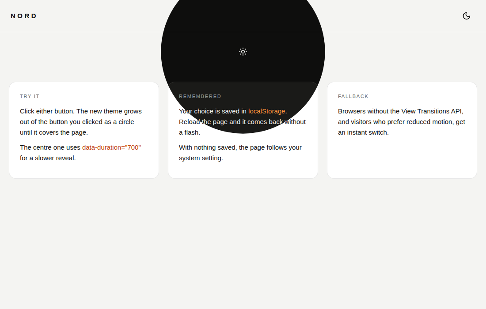

# Animated Theme Toggler

A light/dark switch in plain JavaScript, rebuilt from Magic UI's React `AnimatedThemeToggler`. Click it and the new theme grows out of the button as a circle until it covers the whole page.



- Plain HTML, CSS and about 70 lines of vanilla JS. It doesn't need React, `lucide-react` or Tailwind.
- The theme is a `dark` class on `<html>`, the same as shadcn/Tailwind's `darkMode: "class"`. It's saved to `localStorage` under `theme`.
- The reveal uses the View Transitions API. Browsers without it, and visitors who prefer reduced motion, get an instant switch.
- All classes are prefixed with `ui-theme-toggle`. The reveal CSS only applies while a toggle is running, so other view transitions on your site aren't affected.
- Any number of buttons can share the page, and all of them stay in sync.

Open `index.html` for the demo.

## Use it on any site

1. Paste this as early as you can in `<head>`. It applies the saved theme, or the system theme if nothing is saved, before the first paint, so the page doesn't flash:
   ```html
   <script>
     (function () {
       var saved = null;
       try { saved = localStorage.getItem("theme"); } catch (e) {}
       var dark = saved ? saved === "dark" : window.matchMedia("(prefers-color-scheme: dark)").matches;
       document.documentElement.classList.toggle("dark", dark);
       document.documentElement.style.colorScheme = dark ? "dark" : "light";
     })();
   </script>
   ```
2. Include `style.css` in the `<head>` and `script.js` before `</body>`.
3. Paste the button where you want it:

```html
<button class="ui-theme-toggle" type="button" data-ui-theme-toggle aria-pressed="false">
  <svg class="ui-theme-toggle__icon ui-theme-toggle__moon" viewBox="0 0 24 24" aria-hidden="true"><path d="M12 3a6 6 0 0 0 9 9 9 9 0 1 1-9-9Z"/></svg>
  <svg class="ui-theme-toggle__icon ui-theme-toggle__sun" viewBox="0 0 24 24" aria-hidden="true"><circle cx="12" cy="12" r="4"/><path d="M12 2v2M12 20v2M4.93 4.93l1.41 1.41M17.66 17.66l1.41 1.41M2 12h2M20 12h2M6.34 17.66l-1.41 1.41M19.07 4.93l-1.41 1.41"/></svg>
  <span class="ui-theme-toggle__sr">Toggle theme</span>
</button>
```

4. Style your dark theme with `html.dark` (or `.dark`) selectors, for example:
   ```css
   :root     { --bg: #ffffff; --fg: #111111; }
   html.dark { --bg: #0e0e0d; --fg: #f2f2ee; }
   body      { background: var(--bg); color: var(--fg); }
   ```

The React demo's `<div className="flex justify-center p-6">` wrapper becomes `<div style="display:flex; justify-content:center; padding:24px">` around the button.

## Mapping from the React version

| React | Plain JS |
| --- | --- |
| `<AnimatedThemeToggler />` | The `<button data-ui-theme-toggle>` markup above |
| `duration={600}` | `data-duration="600"` on the button (default `400`) |
| `className="…"` | Add your classes to the button |
| `lucide-react` `Sun` / `Moon` | Inline SVGs with the same paths. CSS shows the right one. |
| `useState` + `MutationObserver` | One shared `MutationObserver` updates `aria-pressed` on every button |
| `flushSync` inside `startViewTransition` | Not needed. The class change is already synchronous. |

## Behaviour

| Action | Result |
| --- | --- |
| Click (light theme, moon icon) | Dark theme grows out of the button as a circle |
| Click (dark theme, sun icon) | Light theme grows out of the button as a circle |
| Reload | The saved theme comes back with no flash |
| No saved theme | Follows `prefers-color-scheme` |
| No View Transitions API, or reduced motion | Switches instantly |

## Tokens

Set these on `.ui-theme-toggle` or on any ancestor element.

| Token | Default | Purpose |
| --- | --- | --- |
| `--ui-theme-toggle-size` | `40px` | Button width and height |
| `--ui-theme-toggle-icon` | `20px` | Icon size |
| `--ui-theme-toggle-stroke` | `2` | Icon line weight |
| `--ui-theme-toggle-hover` | `rgba(127,127,127,.14)` | Hover background |
| `--ui-theme-toggle-radius` | `999px` | Button corner radius |
