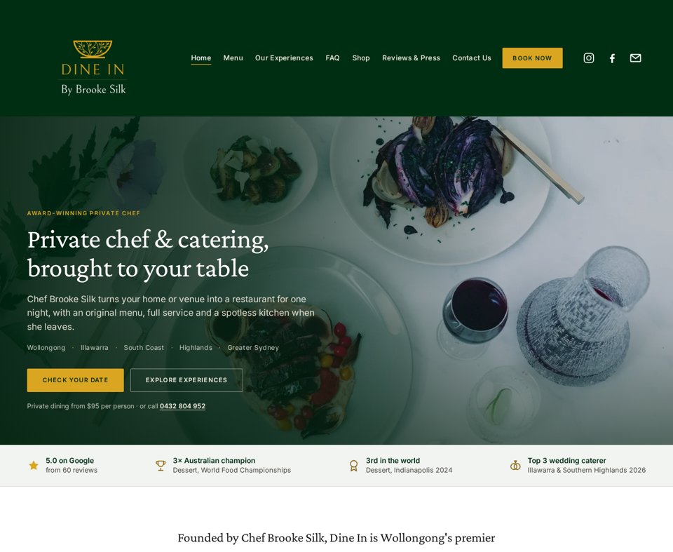

# Dine In (v2)

The working copy of the [Dine In baseline](../dine-in-baseline/), where new UI components are tried out before the real site at [dine-in.com.au](https://dine-in.com.au/) is upgraded. The baseline stays untouched for side-by-side comparison. It has the same pages, navigation, colours, copy, images, menus, prices and links as the live Squarespace site, and you can edit it directly with no build step and no platform lock-in.



## Changes from the baseline

### Round 6: Gift card funnel

`shop/egift-card.html` was the stock product page: one image, a value dropdown and "Purchase". It's now a gifting flow, built around the site's own gift-card rule from the cancellation policy: non-refundable, transferable, and redeemable for any Dine In experience within 365 days of purchase.

| Part | What it does |
| --- | --- |
| **Live card preview** | A green and gold card that shows the occasion headline, the amount, "For …", the message and "From …" as the buyer types. |
| **Three steps** | 1. Occasion chips (Birthday, Anniversary, Thank you, Christmas, Just because). Each one sets the card headline and suggests a message, but never overwrites one the buyer has typed. 2. Amount tiles (A$50 / A$75 / A$100 / A$200), which must be chosen, with an inline error if not. 3. To, From, a message of up to 200 characters with a counter, recipient email and a date to send. The button follows the amount: "Add gift card — A$100". |
| **Cart** | Each personalised gift is its own cart line, with its details listed under it. Everything shown in the cart is now HTML-escaped (`esc()` in `site.js`), because gift messages are text people typed. On phones the cart row stacks so the details stay readable. |
| **Terms strip** | Any experience · 365 days · Transferable · Non-refundable, linked to the new `cancellation-policy.html#gift-cards` anchor. |
| **How it works + redeem** | Three steps, then a **Received a Dine In gift card?** band. Its button opens `book.html?src=gift-card-redeem&gift=1`, which fills the message with "I have a Dine In gift card." and adds a Gift card row to the review summary. |
| **Cross-sell** | A link to the 5-course Degustation voucher (A$130 per person, min. 6). |
| **SEO** | `Product` + `AggregateOffer` JSON-LD (AUD 50–200) and a fuller meta description. |

**Deep links and attribution**

- `shop/egift-card.html?amount=100&occasion=birthday&src=home` pre-selects the amount and occasion. `src` is saved on the cart line.
- Inbound links now carry a `src`:
  - homepage gift card (`home`)
  - booking success upsell (`book-success`)
  - cooking classes (`classes`)
  - shop (`shop`)
  - every footer (`footer`)
  - new "Give it as a gift" buttons in the closing blocks on Experiences (`experiences`) and Menu (`menu`)

### Round 5: Menu page

The menu now leads into a booking instead of ending the visit. Every dish, description and price is the existing menu text. The only wording changes are casing ("KINGFISH TARTARE" becomes "Kingfish Tartare") and moving the (V) and award marks into badges.

| Part | What it does |
| --- | --- |
| **Head** | Adds "Dietaries catered for at no extra cost" (from the booking page) and a 3-step "Pick a menu → shortlist → send to Brooke" guide. |
| **Tabs** | Each tab shows a starting price, e.g. "Banquet $110 pp". The tab bar sticks under the sticky bar while you scroll; on phones it sticks to the top and swipes sideways. Clicking a tab updates the URL hash, so the address bar is always a shareable link. |
| **Menu facts** | Each menu opens with how it's served, the price, the guest minimum and how choosing works. All of it comes from the Experiences cards and the menu itself. It ends with **Enquire with this menu** (`book.html?exp=…&src=menu&menu=<slug>`). |
| **Dish cards** | Two columns on desktop. The five (V) dishes get a V badge (with a legend), and the cheesecake gets a gold "3rd in the world" badge. Options that sat in the price field (grazing, the banquet pasta) now read as one line. |
| **Shortlist** | A **+ Shortlist** button on all 94 dishes. A tray (bottom right on desktop, a collapsible sheet above the Call / Book bar on phones) groups the picks by menu. Sections with a rule show a count, e.g. "1 of 2 shortlisted"; it guides but never blocks. **Send my shortlist to Brooke** opens the booking form with the matching experiences ticked and the message filled in, e.g. "Dishes I'd love: Banquet: Pulled Pork Shoulder; Canapés: Mini Pavlovas". The shortlist is kept in `localStorage`, and the page still works if storage is blocked. |
| **Print** | **Print this menu** prints only the open menu. The browser's own Print prints all six. Buttons, tabs and the tray are left out of print. |
| **No JavaScript** | All six menus show one after another with their own headings, and `menu.html#banquet` still jumps to the Banquet menu. Before this round, only the spring menu showed without JS. |
| **SEO** | `Menu` → `MenuSection` → `MenuItem` JSON-LD for all 94 dishes. Only the five (V) dishes are tagged `VegetarianDiet`. |

**New booking parameters**

- `menu=<slug>`: added to the hidden `source` field, e.g. `menu:banquet`.
- `dishes=<text>`: fills the message field, only if it's empty (600 characters at most).

### Round 4: Experiences redesign

`experiences.html` is where the homepage, the landing pages and the FAQ all send people to choose. Until now it still ran the live site's Squarespace code block: about 290 lines of inline CSS and 300 lines of script that rebuilt the cards on load, a hidden filter dropdown, a home-made modal, and titles in a font that was never loaded. It is now plain HTML in the site's design system. Every price, tier and detail is the page's own text.

| Part | What it does |
| --- | --- |
| **"Which experience suits me?"** | Three tappable questions (occasion, guests, style). It shows a best match and a runner-up, each with a reason and a "from" price, and gives the matching card a gold ring. "Check your date" opens `book.html?exp=…&guests=…&src=experiences-picker&occasion=…`. |
| **Filter chips** | All / Private dining / Cooking classes / Catering & events / Degustation, each with a count, plus a live "Showing 3 of 6" line. The choice is kept in the URL (`?type=catering`). On phones the chips sit in one swipeable row. |
| **Six static cards** | Image, "from" price, best-for tags, every price tier, the minimum, and Enquire + Details. The ids are unchanged, so `experiences.html#canapes` etc. still land on the right card. |
| **Compare all six** | A table: best for, guests, format, from price, what's included, waitress service. On phones it scrolls sideways with the first column fixed. |
| **Details** | Each "Details" link goes to a full in-page details section (`#details-canapes`), which works with JavaScript off. With JavaScript it opens a native `<dialog>` instead: Escape closes it, the backdrop closes it, and focus returns to the card. The dialog offers Enquire, the matching menu tab and the matching landing page. |
| **SEO** | An `ItemList` of six `Service` + `Offer` entries in JSON-LD. |

**Picker rules.** These are based on the site's own minimums.

| Style | Recommends | Runner-up |
| --- | --- | --- |
| Hands-on (or occasion "Learn to cook") | Private Cooking Class | Private Dining |
| Standing & mingling, 20+ guests | Canapés | Grazing Boards |
| Standing & mingling, under 20 | Grazing Boards | Canapés |
| Shared feast, 12+ guests | Banquets | Grazing Boards |
| Shared feast, under 12 | Private Dining | Grazing Boards |
| Seated & served | Private Dining | 5 Course Degustation |

- **Minimums:** if the guest range starts below the experience's minimum, the result shows the site's rule, e.g. "Minimum 6 guests (or equivalent minimum charge)".
- **Occasion links:** a Wedding occasion adds a link to `weddings.html`; a Work event adds `corporate-events.html`.

**New deep links**

- `experiences.html?type=dining|classes|catering|degustation` opens the page already filtered.
- `experiences.html#details-<id>` opens the full details for one experience.
- `menu.html#spring|plant-based|banquet|sides|canapes|grazing` opens that menu tab. The hash is re-read when it changes.

### Round 3: occasion landing pages

Three pages written for the visitors who search for something specific, each usable as an ad or social-post destination. They share one template: hero with a page-specific H1, proof strip, priced packages, how it works, FAQ answers reused from `faq.html`, proof, and a closing CTA. Every CTA opens the booking form pre-filled and tagged with the page it came from.

| Page | Built for | Conversion step |
| --- | --- | --- |
| `weddings.html` | "wedding catering Illawarra / South Coast / Southern Highlands" | **Request the wedding package**: opens the booking form with Wedding Packages ticked and the message filled in. The Google reviews widget sits on the page. |
| `corporate-events.html` | "corporate catering / team building Wollongong, Sydney" | **Budget estimator** (banquet, canapés, grazing, class, client dinner), then "Check your date with these numbers". |
| `cooking-classes.html` | "private cooking class Wollongong" | **Class estimator** (pasta, group, cake decorating, masterclass), plus a gift-card cross-sell. |

- **Estimator:** guests × per-person price, using each package's minimum guest count. Waitress service is added for more than six guests at $135 for 2 hours plus $25 an hour, from the FAQ. Grazing uses the site's three price tiers. Every result is labelled indicative.
- **Booking pre-fill parameters:** `exp`, `date`, `guests`, plus three new ones:
  - `src`: the landing page, stored in a hidden `source` field.
  - `occasion`: shown in the review summary.
  - `package=1`: pre-fills the wedding package request.
  - Example: `book.html?exp=party-packs&guests=20&src=corporate&occasion=Christmas%20party%20banquet`
- **Ways in:** a "Planning something specific?" row on the homepage, an Occasions line in every footer, a pointer on the Experiences page, and links in two FAQ answers. The header nav is unchanged.
- **SEO:** `Service` + `Offer`, `FAQPage` and `BreadcrumbList` JSON-LD on each page, plus `sitemap.xml` and `robots.txt`.
- **Images:** the heroes are the 2500px originals from the live site, served as 1920px and 960px WebP (85–131 KB at 1920px).

### Round 2: the October 2026 website review

The review pack (audit, Squarespace CSS, footer JS) was written as Squarespace code injection. This copy is plain HTML, so each finding is fixed in the source instead: real `<h1>`s, real `required` fields, real buttons, and no DOM patching at runtime. On top of the fixes, the site is rebuilt around one funnel: **interest → trust → choose → enquire**. The main goal is a booking enquiry, then a gift card sale, then a phone call.

| Area | Change |
| --- | --- |
| Home | Rebuilt as a sales page, in this order: hero with a real H1, "Check your date" and the starting price; trust strip (5.0 · 60 reviews, 3× Australian champion, 3rd in the world, Top 3 wedding caterer); intro; three-step "How it works"; three experience cards with "from" prices; proof band with the Nine Travel quote and the 5.0 score; Chef card; As Featured In; gift cards; a closing "Check your date" mini form that carries its answers to the booking page. |
| Book | A three-step enquiry (Experience → Your event → Your details) with tappable tiles instead of 16px checkboxes, a progress bar and per-step validation. It pre-fills from the URL (`book.html?exp=private-dining&date=2026-12-12&guests=8`), shows a review summary, then a "What happens next" success screen with a gift-card upsell. With JS off it shows as one long form. |
| Every page | Gold "Book Now" button in the header; a sticky booking bar after the hero (desktop); a Call / Check your date bar (phones); a closing CTA block on Experiences, Menu, FAQ, Reviews and product pages; tappable `0432 804 952` in the footer; one real H1; Open Graph tags. |
| Experiences | (Rebuilt in Round 4.) "Enquire Now" and the Details pop-up pre-select that experience on the booking form; cards have anchors (`experiences.html#private-dining`); the gold buttons now pass contrast. |
| Design system | Serif headings (Crimson Pro, or kepler-std if the Adobe kit is loaded) with Inter for body and UI; 17px body text, a 68-character line length and 1.15 heading line-height; a primary / secondary / ghost button system with 2px corners; a gold focus ring; reduced-motion and print styles. Every value is a token at the top of `assets/css/site.css`. |
| Performance | The 4 MB GIF is now a 38 KB WebM / 71 KB MP4 loop; the hero is served at 1920px and 960px; the experience photos are recompressed; the hero is preloaded; images below the fold lazy-load. The homepage now loads 1.73 MB of local assets, down from 4.84 MB. |
| SEO | Page titles target the service area, there's an Open Graph image (`assets/images/og-image.jpg`), and the homepage has `LocalBusiness` / `FoodEstablishment` JSON-LD. |
| Analytics hooks | Every CTA carries a `data-cta="…"` name (`hero-book`, `sticky-book`, `mobile-call`, `book-submit`, etc.), so funnel tracking can be added without touching the markup again. No tracker is installed. |

### Round 1

| Page | Change |
| --- | --- |
| Home | The "Meet Chef Brooke Silk" panel shows the animated [Chef card](../../components/chef-card/) beside Brooke's story. The intro plays when the card scrolls into view. Files: `assets/css/chef-card.css`, `assets/js/chef-card.js`, `assets/images/brooke-silk.webp`. |

## Review findings

Every finding re-measured with Playwright at 1440px and 390px after the changes:

| # | Finding (live site) | Status in v2 |
| --- | --- | --- |
| P1.1 | 4,558px of the homepage with nothing to click | Done. A booking CTA is on screen at every scroll position, desktop and phone (the sticky bar or bottom bar plus in-page CTAs). The longest in-page stretch is 1,068px on desktop. |
| P1.2 | Reviews and FAQ pages end with no CTA | Done. Closing CTA blocks on Reviews, FAQ, Menu, Experiences and product pages, with copy written for each page. |
| P1.3 | Every button identical; "Book Now" looks like a nav link | Done. Gold primary, outlined secondary and ghost buttons; "Book Now" is a gold button in the header. |
| P1.4 | Phone number not tappable | Done. `tel:+61432804952` in the footer, Contact page, hero, bars and CTA blocks. |
| P2.1 | Tap targets under 44px | Done. Zero visible controls under 44×44 on any page. |
| P2.2 | No `<h1>` on any page | Done. Exactly one H1 on every page (15/15). |
| P2.3 | 14px body text | Done. 17px body, 1.65 line-height, 68ch line length. |
| P2.4 | Focus invisible; skip link hidden | Done. Gold `:focus-visible` ring; skip link appears on focus. |
| P2.5 | Images without alt text | Done. Zero images without `alt`; decorative video is `aria-hidden`. |
| P2.6 | FAQ jumps H2 → H4 | Done. Questions are H3s in the markup. |
| P2.7 | No reduced-motion support | Done. Transitions and animations off; the looping video pauses. |
| P3.1 | No `required` fields | Done. Experience, guests, location, first and last name, mobile and email are required, with inline errors. |
| P3.2 | 14px inputs make iOS zoom | Done. Every input is 16px or larger. |
| P3.3 | Wrong mobile keyboards, no autofill | Done. `tel`, `email`, `numeric` and `date` inputs, with `autocomplete` on every field. |
| P4 | Flat typography, loose headings, 5.6px corners | Done. Serif and sans pairing, 1.15 line-height, 2px corners. |
| P5 | Heavy homepage | Done. See Performance above. |
| D1–D4 | Manual actions | Name and phone are now required (date stays optional, with "My date is flexible"); images compressed; type pairing switched on. |

Every new text colour pair passes WCAG AA:

| Pair | Ratio |
| --- | --- |
| Green on gold (buttons) | 6.7:1 |
| Ivory on green | 13.1:1 |
| Gold text on white | 5.3:1 |
| Body text | 18.8:1 |
| Secondary text | 9.5:1 |
| Captions | 6.8:1 |
| Error red | 6.6:1 |

## Confirm with Brooke before going live

- **Reply time:** "usually within one business day" on the booking success screen. It's marked `<!-- CONFIRM WITH BROOKE -->` in `book.html`.
- **Required fields:** name, mobile and email are now required, and Subject has been dropped (it's composed automatically from the answers).
- **The "Check your date" wording** used on CTAs across the site.
- **Open Graph and JSON-LD URLs** need to be absolute (`https://dine-in.com.au/...`) on the real site. `sitemap.xml` already uses the live domain.
- **Landing-page packages and "from" prices** as worded on the three new pages, including the wedding package contents (marked `<!-- CONFIRM WITH BROOKE -->` in `weddings.html`).
- **Estimator assumptions:** 3 hours of waitress service by default, and one waitress for any group size (marked in the estimator markup).
- **"Quotes and invoices provided"** on the corporate page.
- **Menu choosing rules:**
  - The banquet menu says "Choose 4–5" sides, but the Experiences page says "three sides". The menu page shows the menu's wording.
  - Grazing says "choose three of five" but lists eight groups.
  - The Sides tab isn't tied to one experience, so its buttons offer Private Dining or Banquets.
- **Gift card delivery:** whether the live store emails the card to the buyer or the recipient, and whether a send date and message are supported. The test page collects them but makes no delivery promise. Also confirm the 200-character message limit and the five suggested messages.
- **Plant-based dishes** carry no vegan or gluten-free labels. Only the five dishes the site marks (V) are badged. If Brooke wants dietary labels, she needs to supply them per dish.

## Run it

Open `index.html` in a browser, or serve the folder so every page and the reviews widget work as they do online:

```sh
cd sites/dine-in-v2
python3 -m http.server 8000   # then open http://localhost:8000
```

## Pages

| File | Live page | What's on it |
| --- | --- | --- |
| `index.html` | `/` | Hero, trust strip, intro, How it works, experience cards, proof band, Chef card, As Featured In, gift cards, "Check your date" mini form |
| `menu.html` | `/menu` | Six tabbed menus (Private Dining spring, Plant-Based, Banquet, Sides, Canapés, Grazing), each with price and serving facts, plus a dish shortlist that hands off to the booking form |
| `experiences.html` | `/experiences` | "Which experience suits me?" picker, filter chips, six priced cards, a comparison table and Details dialogs |
| `faq.html` | `/faq` | Three groups of accordions (18 questions), closing CTA |
| `shop.html` | `/shop` | Chilli Jam, Degustation voucher, eGift Card |
| `shop/*.html` | `/shop/p/*` | Product pages with gallery, quantity, value picker and Add To Cart |
| `cart.html` | `/cart` | Cart (stored in the browser, see below) |
| `testimonials.html` | `/testimonials` | Reviews & Press: awards and media, plus the live Google reviews widget |
| `contact.html` | `/contact` | Email, phone, hours, greyscale map |
| `weddings.html`, `corporate-events.html`, `cooking-classes.html` | new | Occasion landing pages with packages, estimators and pre-filled booking links |
| `book.html` | `/book` | Three-step booking enquiry with pre-fill, summary and success screen |
| `privacy-policy.html`, `terms-and-conditions.html`, `cancellation-policy.html` | same | Policy pages linked from the footer |

## Files

| Path | What it is |
| --- | --- |
| `assets/css/site.css` | All styles. Colour, font and spacing tokens sit at the top in `:root` |
| `assets/js/site.js` | Mobile menu, FAQ accordions, menu tabs, product gallery, cart, form validation, video |
| `assets/images/` | Every image from the live site, downloaded locally |

The header and footer are repeated in each page, so a nav change needs making in every file. The Experiences cards, details and comparison table are static HTML in `experiences.html`. A price change means editing the card, its details section, the table row and the JSON-LD, plus the picker's one-line summary in `assets/js/site.js`.

## Brand tokens

| Token | Value | Used for |
| --- | --- | --- |
| `--green` | `#002E13` | Header, "As Featured In" band |
| `--gold` | `#DAA520` | Logo gold |
| `--sage` | `#F1F4F0` | Inset panels on the homepage |
| Experiences gold | `#D1A03F` | "Enquire Now" buttons on the experience cards |

## Where it differs from the live site

- **Fonts.** The live site uses Adobe Fonts (Kepler Std and Adobe Caslon Pro), which are licensed to the Squarespace site. This copy uses the closest free Google Fonts, Crimson Pro and Libre Caslon Text. If an Adobe Fonts kit with `kepler-std` and `adobe-caslon-pro` is added to the pages, they are used automatically. Then set `--display-scale` and `--large-scale` to `1` in `site.css`.
- **Booking form.** Validates like the real one, then shows a thank-you message, but sends nothing. Hook it up to a form service (Formspree, Netlify Forms, etc.) when it's ready.
- **Shop and cart.** Add To Cart works and the cart page totals it up, but the cart is stored only in your browser and checkout is turned off.
- **Video and reviews.** The "As Featured In" video streams from Squarespace's video CDN, and the Google reviews come from the same Elfsight widget the live site uses. Both need an internet connection and keep working only as long as those accounts do.
- **Map.** A Google Maps embed of Wollongong in greyscale, in place of Squarespace's map block.
- **Not copied:** the unlinked placeholder blog (`/blog-1-1`), which isn't in the site's navigation.
