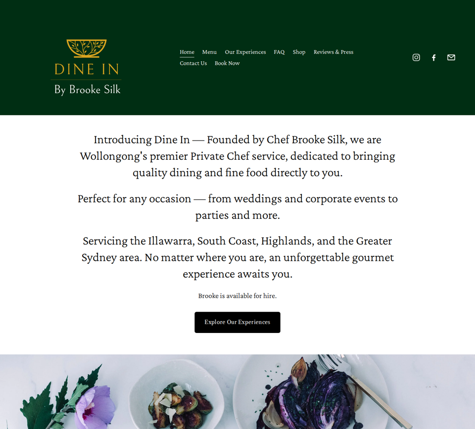

# Dine In — test site

A working copy of [dine-in.com.au](https://dine-in.com.au/), rebuilt as plain HTML, CSS and JS so new UI components can be tried on it before the real site is upgraded. It has the same pages, navigation, colours, copy, images, menus, prices and links as the live Squarespace site, and you can edit it directly with no build step and no platform lock-in.



## Run it

Open `index.html` in a browser, or serve the folder so every page and the reviews widget work as they do online:

```sh
cd sites/dine-in
python3 -m http.server 8000   # then open http://localhost:8000
```

## Pages

| File | Live page | What's on it |
| --- | --- | --- |
| `index.html` | `/` | Intro, banner, "How does it work?", Read Our Reviews poster, Meet Chef Brooke Silk, As Featured In logos and video, Book Now panel |
| `menu.html` | `/menu` | Six tabbed menus: Private Dining (spring), Plant-Based, Banquet, Sides, Canapés, Grazing |
| `experiences.html` | `/experiences` | Six experience cards with pricing, a category filter and Details pop-ups |
| `faq.html` | `/faq` | Three groups of accordions (18 questions) |
| `shop.html` | `/shop` | Chilli Jam, Degustation voucher, eGift Card |
| `shop/*.html` | `/shop/p/*` | Product pages with gallery, quantity, value picker and Add To Cart |
| `cart.html` | `/cart` | Cart (stored in the browser, see below) |
| `testimonials.html` | `/testimonials` | Reviews & Press: awards and media, plus the live Google reviews widget |
| `contact.html` | `/contact` | Email, phone, hours, greyscale map |
| `book.html` | `/book` | The full booking enquiry form |
| `privacy-policy.html`, `terms-and-conditions.html`, `cancellation-policy.html` | same | Policy pages linked from the footer |

## Files

| Path | What it is |
| --- | --- |
| `assets/css/site.css` | All styles. Colour, font and spacing tokens sit at the top in `:root` |
| `assets/js/site.js` | Mobile menu, FAQ accordions, menu tabs, product gallery, cart, form validation, video |
| `assets/images/` | Every image from the live site, downloaded locally |

The header and footer are repeated in each page, so a nav change needs making in every file. The Experiences cards are the live site's own code block, carried over as-is (only the image and link paths changed). Its styles and data live inside `experiences.html`.

## Brand tokens

| Token | Value | Used for |
| --- | --- | --- |
| `--green` | `#002E13` | Header, "As Featured In" band |
| `--gold` | `#DAA520` | Logo gold |
| `--sage` | `#F1F4F0` | Inset panels on the homepage |
| Experiences gold | `#D1A03F` | "Enquire Now" buttons on the experience cards |

## Where it differs from the live site

- **Fonts.** The live site uses Adobe Fonts (Kepler Std and Adobe Caslon Pro), which are licensed to the Squarespace site. This copy uses the closest free Google Fonts, Crimson Pro and Libre Caslon Text. If an Adobe Fonts kit with `kepler-std` and `adobe-caslon-pro` is added to the pages, they are used automatically. Then set `--display-scale` and `--large-scale` to `1` in `site.css`.
- **Booking form.** Validates like the real one, then shows a thank-you message, but sends nothing. Hook it up to a form service (Formspree, Netlify Forms, etc.) when it's ready.
- **Shop and cart.** Add To Cart works and the cart page totals it up, but the cart is stored only in your browser and checkout is turned off.
- **Video and reviews.** The "As Featured In" video streams from Squarespace's video CDN, and the Google reviews come from the same Elfsight widget the live site uses. Both need an internet connection and keep working only as long as those accounts do.
- **Map.** A Google Maps embed of Wollongong in greyscale, in place of Squarespace's map block.
- **Not copied:** the unlinked placeholder blog (`/blog-1-1`), which isn't in the site's navigation.
